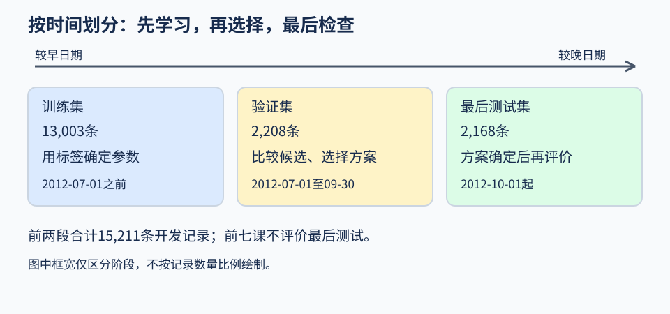

# 第05课 · 数据怎样分，才能检查你真正关心的预测？

上一课检查数据有没有漏记录。这一课即使数据完整，还要问：拿哪些记录训练，用哪些记录检查？

如果你想预测以后的日期，却把前后日期混在一起评价，得到的分数可能没有回答原来的问题。先用六天的人工记录看清楚。

## 1. 六天记录，各自承担什么任务？

假设六天按时间排列，目标是每天用电量，单位为千瓦时（kWh）。

|日期|用途|本步能否读取用电量|
|---|---|---|
|第1、2、3日|训练|可以，用来确定参数|
|第4、5日|验证|预测完成后读取，用来比较|
|第6日|最后测试|先不看，方案确定后再评价|

训练用电量是10、20、30，均值为20kWh。均值模型对第4、5日都预测20kWh。

假如验证实际是40、50，两个绝对误差为20、30kWh，平均绝对误差（mean absolute error，MAE）是(20+30)÷2=25kWh。这说明它在后来两天表现不好，不能为了让结果好看，先把40、50加入均值，再称为原方案的验证。

加入后均值变成(10+20+30+40+50)÷5=30kWh。再对40、50评价，会得到15kWh的MAE，看起来更好，但验证答案已经参与确定参数。文件名叫“训练”还是“验证”，不会改变这个事实。

日期条件也要看等号：“日期<4”不含第4日；“4≤日期<6”含第4、5日，不含第6日。

## 2. 三种职责，不是三个随意的文件名

给记录安排这些职责，叫作**数据划分（data splitting）**。

- **训练集（training set）**：确定均值、回归系数等参数。
- **验证集（validation set）**：比较候选、选择方法或设置。
- **测试集（test set）**：选定方案后作最后评价。

训练与验证合起来称为**开发数据（development data）**。验证可以参与反复开发，但要说明选择过程；看过测试再改方案，就需要新的独立测试数据。

本课只使用13,003条训练加2,208条验证，共15,211条开发记录。后面的2,168条测试记录继续封存，不用它们挑选划分或模型。

## 3. 时间划分与随机划分，回答的条件不同

单车项目原来的**时间划分（temporal split）**是：
- 训练：日期早于2012-07-01。
- 验证：2012-07-01起，早于2012-10-01。

较早记录用于训练，较晚记录用于验证，比较接近“从过去推向后来日期”的用途。

先沿箭头看三个阶段，再看每段标签用于什么。框的宽度不表示样本多少；测试段留到方案确定后。

另一种是**随机划分（random split）**：只把15,211条开发记录打乱，再取13,003条训练、2,208条验证。固定**随机种子（random seed）**，可以重复得到同一次打乱。

随机方案的验证日期与时间方案不同。即使随机方案的MAE更低，也不能直接宣布“预测未来更好”，因为两个分数面对的记录已经不同。

如果关心相似历史条件中的新记录，随机划分可以提供一种开发检查；如果关心季节、时间结构变化，时间验证更贴近这种考验。不要按哪个分数好看来倒推用途。

## 4. 换了训练记录，参数也要重新计算

假设使用温度的一元线性回归（simple linear regression）：

**预测 = 截距 + 斜率×temp。**

每种划分都应只用自己的训练记录拟合。不能在全部15,211条上先算一次系数，再把其中一部分叫验证；也不能直接照搬时间方案的系数，声称随机方案已经重新训练。

均值基线同理：它的预测常数必须来自本方案的训练cnt。

如果做**标准化（standardization）**，例如减去均值（mean）再除以标准差（standard deviation），均值和标准差也只从训练部分计算。用训练均值填补缺失值时也是如此；验证数据继续使用训练得到的处理规则。

在参数文件里保存训练记录数、输入字段、截距和斜率，可以帮助核查来源。文件可叫`model.json`，具体名字由自己的程序决定。工具函数`fit_simple_line`见[代码工具](../docs/CODE_TOOLKIT.md)；默认入口不会仅因配置里写了方法名称就自动完成比较。

## 5. 零误差也可能只是把答案加回来

某小时的数据是：

**casual=30，registered=70，cnt=100。**

用casual+registered预测cnt，会得到100，绝对误差为0。但前两项就是已经发生的租借次数的组成部分，预测总数时不能预先假定知道它们。

这属于**数据泄漏（data leakage）**。它说明程序能加总，不说明模型能预测未知结果。

若为了学习刻意核对这个恒等式，应明确标为错误示范`INVALID`，与合法候选分开。不必人人另写完整错误模型，也不能把它当成获胜方案。

## 6. 预测后来日期，与预测陌生对象也不同

假设设备甲、乙各记录两次，设备丙记录一次。

如果目标是预测甲乙以后的表现，使用较早观测训练、较晚观测验证比较贴近任务。

如果目标是预测训练时从未见过的丙，就要让丙的全部记录留在验证中。按设备把同一对象的记录放在同一侧，叫作**分组划分（group split）**。

例如：
- 训练：甲1、甲2、乙1、乙2；
- 验证：丙1。

若改成甲1训练、甲2验证，验证中出现的仍是见过的设备，不能据此保证陌生设备也有效。

检查时可以列两份设备编号集合：若研究陌生设备，两份集合不能有交集。只检查记录编号不重复还不够，因为甲1、甲2编号不同，却属于同一台设备。

Bike文件没有站点ID或骑行者ID，因此不能声称做了新站点、新骑行者验证。同一天各小时可能共享天气或事件，可以考虑按天成组检查，但这与按站点分组不是一回事。

## 7. 实验前写清，运行后逐项核对

按[任务页](README.md)组织自己的程序。比较划分时，至少保存每一侧的记录编号、条数、日期范围、训练参数和评价指标。

先检查：
1. 训练与验证是否重叠？
2. 测试记录有没有误入开发数据？
3. 所有需要学习的处理参数是否只来自训练？
4. 各方案是否按各自训练集重新拟合？
5. 结论有没有超出所采用划分能检查的条件？

不同验证集的分数可以并列描述，但不能当作只改变模型、其他条件完全相同的胜负判断。

## 8. 练习与不同完成程度

- **基础完成：**复算六天小例，解释为什么加入验证答案后得到的30kWh不能作为原训练模型的独立验证结果。
- **完整完成：**按原项目要求比较合理的划分，保存编号和训练来源，用自己的使用场景解释结果。固定种子只保证可重跑，还要说明划分为何适合用途。
- **扩展练习（选做）：**把目标换成“陌生学校的用电量”。画出按日期与按学校两种划分清单，说明各自隔离了什么、还需要哪些新字段。这里只作设计，不假装Bike提供了学校或站点信息。

最后试着补全一句话：“我的验证能检查____，但还不能保证____。”这比只写一个更低的分数更有用。
