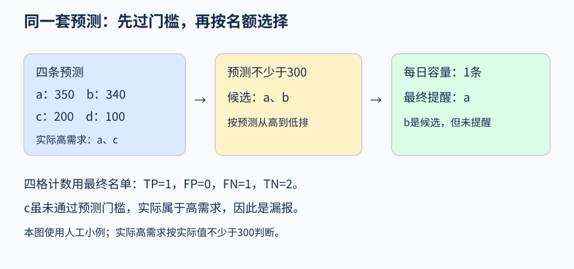

# 第06课 · 预测较准，提醒就一定更好吗？

一个模型可以给每个小时预测租借次数，但一天可能只能处理少量提醒。此时要分开回答三个问题：

1. 预测与实际相差多少？
2. 更在意高估还是低估？
3. 名额有限时，最后提醒哪些小时？

下面用同一天四条人工记录，一步步算。

## 1. 先只评价预测，不考虑提醒

|编号|预测（次/小时）|实际（次/小时）|预测−实际|绝对误差|
|---|---:|---:|---:|---:|
|a|350|400|−50|50|
|b|340|200|140|140|
|c|200|500|−300|300|
|d|100|50|50|50|

a低估50，b高估140。**平均绝对误差（mean absolute error，MAE）**把四条偏离大小平均：

**(50+140+300+50)÷4=135次/小时。**

这里每条记录都是一个小时，所以单位写成次/小时。它不是人数，也不是提醒的正确率。

## 2. 如果特别不希望低估呢？

假设使用者认为低估更需要重视，约定低估的误差乘2，高估保持原值。这是本例人为选择的**损失函数（loss function）**，用于比较方案，不代表已经测出了真实经济损失。

先用a核对：它低估50，乘2得到100；b高估140，保持140。c低估300，乘2得到600；d高估50，保持50。因此平均惩罚为：

**(100+140+600+50)÷4=222.5次/小时。**

注意分母仍是4条记录，不是权重之和。这个数与MAE不能当成同一种指标混着比较。两个模型比较时，必须采用同一套惩罚规则。

## 3. 达到阈值，只是先进入候选

现在规定预测达到300次/小时才考虑提醒。300是**提醒阈值（alert threshold）**。

a预测350、b预测340，都进入候选；c和d没有达到阈值。

但是每天最多提醒1个小时，这个上限叫作**每日容量（daily capacity）**。在候选中按预测从高到低选，最后只有a入选。预测相同时按时间先后，不能看实际次数再挑。

|编号|预测≥300，进入候选？|容量1时最终提醒？|实际≥300？|
|---|---|---|---|
|a|是|是|是|
|b|是|否|否|
|c|否|否|是|
|d|否|否|否|

先看候选列，再看最终提醒列：b虽然曾进入候选，最后没有收到提醒。评价提醒效果时，要按最终行为计数。

## 4. 把最终提醒放回四格表

固定本例“实际至少300次/小时”为高需求标准：
- a：提醒且实际高，命中。
- b：没提醒且实际不高，正确未提醒。
- c：没提醒但实际高，漏报。
- d：没提醒且实际不高，正确未提醒。

这种把最终判断与实际情况交叉计数的表，叫作**混淆矩阵（confusion matrix）**。这里“阳性”表示最终提醒：命中是真阳性（true positive，TP），误报是假阳性（false positive，FP），漏报是假阴性（false negative，FN），正确未提醒是真阴性（true negative，TN）。先用中文判断每条记录属于哪一格，再对应缩写即可。

合计命中1、误报0、漏报1、正确未提醒2，即TP=1、FP=0、FN=1、TN=2，四项总和为4。

按从左到右读：预测过门槛后只是候选，还要满足名额限制。四格计数应使用最后名单，不能使用候选名单。

**精确率（precision）**=命中数÷最终提醒数=1÷1=100%。

**召回率（recall）**=命中数÷实际高需求数=1÷2=50%。

精确率高，不代表没有漏报。本例发出的提醒都对，但还漏掉了c。

把容量改为2，b也会收到提醒，多出一次误报。此时最终提醒2次、命中1次，所以精确率变为50%；实际高需求仍是a、c，召回率仍为50%。预测数字没有改变，因此MAE仍为135。这说明提醒容量与预测误差是不同环节。

## 5. 在程序里，对应看哪些字段？

|字段|含义|用a核对|
|---|---|---|
|prediction|预测次数|350|
|cnt|实际次数|400|
|signed_error|预测−实际|−50|
|absolute_error|绝对误差|50|
|weighted_absolute_error|按低估惩罚规则计算的误差|100|
|candidate_alert|预测是否达到提醒阈值|是|
|final_alert|名额筛选后是否最终提醒|是|
|actual_high|实际是否达到高需求标准|是|
|outcome|最终提醒与实际情况合成的四类结果|命中|

在自己的输出里挑一条，按这个顺序重算。每日汇总若保存`candidates`和`selected`，应满足：

**selected≤daily_capacity，并且selected≤candidates。**

共享例子用同一个阈值判断候选与实际高需求。因此若改阈值，要注明实际标准也随之改变；若只想考察发提醒的门槛，就把实际高需求标准固定下来再计数。

## 6. 这是一种离线比较

本例先得到同一天全部已记录小时的预测，再一次性选出最高的候选。这叫作**离线评价（offline evaluation）**。

真实实时系统只能看到已经到达的信息，不能照搬“看完整天再选”。本数据也没有未来天气预报，所以不应把这次计算描述成已可使用的提前排班系统。

计算提醒是否命中，还不等于证明增加车辆会提高租借或改善体验；后者需要行动与效果数据。

## 7. 回到正式数据，怎样作公平比较？

本课仍使用13,003条训练记录、2,208条验证记录，最终2,168条测试记录继续保留。

一种可解释的模型是按小时求训练均值：把训练集中hr相同的记录放在一起，求该组cnt均值，预测时按输入小时查这个值。也可以沿用前课模型。

如果想比较模型，阈值、容量和惩罚规则应保持相同；如果想比较容量，就先固定模型预测。一次改变一项更容易解释结果。

没有提醒时，精确率没有定义；没有实际高需求记录时，召回率没有定义。可在JSON里保存为`null`，不要填100%或零误差。分组评价只计算组内记录，空组也不能评价。

## 8. 练习与不同完成程度

- **基础完成：**按四条小表复算MAE、平均低估惩罚和最终四格计数。不要只检查候选记录。
- **完整完成：**按[任务页](README.md)选择一个与用途有关的比较，保存预测、最终提醒及评价结果。用一条记录和一天的名额分配解释程序。
- **扩展练习（选做）：**只把c的预测从200改为320，容量仍为1。先猜最终提醒会不会改变，再重算误差与四格表。提示：320虽然超过阈值，仍低于a的350。

扩展题核对：c的新绝对误差是500−320=180，MAE=(50+140+180+50)÷4=105次/小时。最后仍只提醒a，漏报c仍在，四格计数不变。这次预测误差改善了，提醒结果却没改善。

还可以单独看工作日7、8、9、16、17、18、19时的表现。按条件选出的子集叫作**切片（slice）**。第8课会正式比较这些通勤时段；现在先记住，切片指标的分母只包括切片里的记录。
