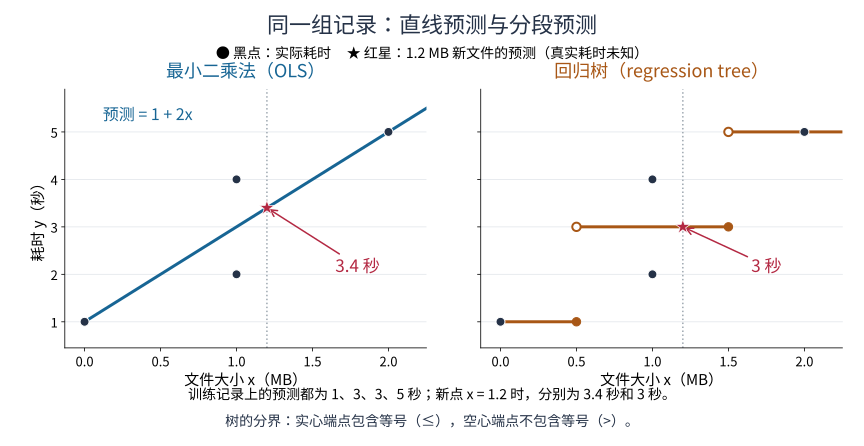
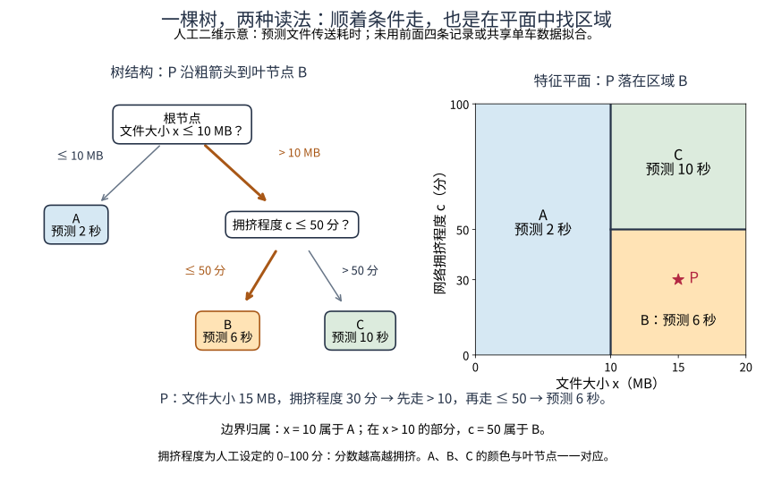

# 第09课 · 直线怎样学，树怎样分？

共享单车数据有很多行，不适合一开始就手算。我们先换一个只有四条记录的小问题，看看两种模型在做什么，再回到共享单车任务。

### 与第8课的对照有何不同？

第8课在共享单车作品中改变输入的表达方式，例如把小时数换成“是否某个小时”的多列信息；第9课先保持模型收到的信息相同，改用直线或浅树表达关系。一个主要研究“给模型什么信息”，另一个研究“模型怎样利用这些信息”，不是要求把同一份作业重复交一次。

下面的文件传送只是能手算的另设小例，正式任务仍回到共享单车。第8课已看过的旧测试集不会重新变成未见数据，本课在原训练/验证部分继续比较。

## 1. 四条记录，已经能看见问题

假设我们记录了文件大小和传送耗时，得到下面这张人工编制的小表。零大小也有1秒耗时，可以理解为建立传送连接的准备时间。

|记录|文件大小x（MB）|耗时y（秒）|
|---|---:|---:|
|1|0|1|
|2|1|2|
|3|1|4|
|4|2|5|

你会发现：同样是1MB，第二次记录用2秒，第三次却用4秒。可能是网络状态不同，也可能有其他没有记录的因素。

如果模型只知道文件大小，它对这两条记录就只能给出同一个预测。因此，我们不是要求模型把所有训练记录都猜中，而是寻找一种整体上偏差较小的规律。用数据确定这条规律，就是**训练**（training）；让模型尽量贴近已有记录，叫作**拟合**（fitting）。

## 2. 先试一条直线

这是最简单的线性模型（linear model）。把预测写成：
$$
\text{预测耗时} = b + w\times \text{文件大小}
$$
这里有两个需要确定的数，也叫模型参数（model parameters）：

- w表示文件每增加1MB，预测耗时增加多少秒，叫斜率（slope）；
- b是文件大小为0时的预测，叫截距（intercept）。

例如， $b=1$ 、 $w=2$ 时，1MB的预测就是 $1+2\times 1=3$ 秒。

可是，为什么选1和2，而不是别的数？我们需要一个比较标准。

### 用误差选系数

对每条记录，先算“ $\text{预测}-\text{实际}$ ”，再平方，最后把四个平方加起来。平方能避免正负误差互相抵消，也会对较大的误差给予更大惩罚。

我们希望这四个平方的合计尽可能小。这种选法叫**最小二乘法**（ordinary least squares，OLS）。

只有一个输入x、并且包含截距时，可以直接计算：

1. 先求x的平均值和y的平均值；
2. 对每条记录算“x减去平均x”和“y减去平均y”；
3. 把两列差值逐行相乘后求和；再把每条“x减去平均x”的差平方后求和。前一个合计除以后一个合计，得到w；
4. 用 $b=\bar y-w\bar x$ 得到截距。

这里 $\bar x=1,\quad\bar y=3$ ，计算如下。

|记录| $x-1$ | $y-3$ |两者相乘| $(x-1)^2$ |
|---|---:|---:|---:|---:|
|1| $-1$ | $-2$ |2|1|
|2|0| $-1$ |0|0|
|3|0|1|0|0|
|4|1|2|2|1|
|合计|||4|2|

于是 $w=4\div 2=2$ ， $b=3-2\times 1=1$ ，得到直线：

$$
\text{预测耗时} = 1 + 2\times \text{文件大小}.
$$

这条公式适用于本例；如果所有x都相同，上述分母为0，就不能这样求斜率。本课不要求背诵公式，重点是看清：系数由训练数据和误差标准决定，不是手工随意挑的。

### 检查这条直线

|文件大小|实际耗时|预测耗时| $\text{预测}-\text{实际}$ |误差的平方|
|---|---:|---:|---:|---:|
|0|1|1|0|0|
|1|2|3|1|1|
|1|4|3| $-1$ |1|
|2|5|5|0|0|
|合计||||2|

作为参照，如果不看文件大小，所有记录都预测平均耗时3秒，平方误差合计是 $4+1+1+4=10$ 。直线把它降到了2。

第二、三条记录仍然不能同时预测准确。模型给了它们相同的3秒，这是仅使用文件大小时的一个折中。

## 3. 为什么评价时又出现MAE？

训练时，我们用平方误差选系数。解释预测好不好时，还可以换一个更直观的指标：**平均绝对误差**（mean absolute error，MAE）。

它的计算是：每条误差（error）去掉正负号，再求平均。

上面直线的四个绝对误差是0、1、1、0秒，所以：

$\mathrm{MAE}=(0+1+1+0)\div 4=0.5$ 秒。

可以说：“在这四条记录上，预测平均偏离实际0.5秒。”

训练采用什么标准，与最后用什么指标评价，是两个可以区分的选择。另外，这里算的是训练记录本身的误差；要判断新记录上是否也好，还需要没有参与训练的记录。用来检查和比较方案的这部分记录，称为验证集（validation set）。

## 4. 决策树不画直线，它把记录分组

决策树（decision tree）用一连串条件判断作预测。

现在换一种做法：先问一个问题，例如“文件大小是否不超过0.5MB”。

- 如果是，就进入左组；
- 如果不是，就进入右组。

每组用组内实际耗时的平均值作预测。如果还要细分，就在其中一组继续问问题。最后不再分的组叫作**叶节点**（leaf node），也可以直接理解为最终分组。

分界数0.5叫作阈值（threshold）。树的训练，就是从候选字段和阈值中选择怎样分组。

### 第一次分在哪里？

仍然用平方误差合计比较。可以尝试两种分法：

|分法|左组耗时与平均值|右组耗时与平均值|分组后的平方误差合计|
|---|---|---|---:|
|不分组|全部为1、2、4、5，平均3|—|10|
| $x\le 0.5$ |1，平均1|2、4、5，平均11/3| $14/3\approx 4.67$ |
|x≤1.5|1、2、4，平均7/3|5，平均5| $14/3\approx 4.67$ |

以第二行为例，左组只有一个记录，预测1，误差为0。右组都预测11/3，因此平方误差合计为：

$$
\begin{aligned}
&(2-11/3)^2+(4-11/3)^2\\
&\quad+(5-11/3)^2=14/3.
\end{aligned}
$$

两种分法并列。在这个小例中，约定按固定顺序选择0.5；并列时怎样处理要固定下来，才能重复得到同一结果。

### 再分一次

第一次分组后，右组还有大小1、1、2三条记录。再问“是否不超过1.5MB”，便得到两个最终分组：

- 大小1、1，实际耗时2、4，平均为3；
- 大小2，实际耗时5，平均为5。

加上最初的左组，整棵树就可以写成三条规则：

-  $x\le 0.5$ ：预测1秒；
-  $0.5<x\le 1.5$ ：预测3秒；
- x>1.5：预测5秒。

这时四条训练记录的预测也是1、3、3、5，平方误差合计为2，与直线相同。

所谓树的深度（tree depth），可以理解为一条记录最多要经过几次这样的条件判断。本例最多判断两次。

## 5. 训练误差相同，新预测却可能不同

假设来了一个1.2MB的文件：

- 直线计算 $1+2\times 1.2$ ，预测3.4秒；
- 树先判断 $1.2>0.5$ ，再判断 $1.2\le 1.5$ ，预测3秒。

这种预测数值的树叫作**回归树**（regression tree）。把刚才的计算画出来，两边使用相同的坐标范围，方便你直接比较。

**图1怎么读**：黑点是实际耗时，线是模型的预测。沿横轴找到1MB，再往上看：两个实际耗时分别为2秒、4秒，两种模型却都预测3秒。红星标出了1.2MB新文件的预测。树在0.5和1.5MB处用实心端点表示包含等号，用空心端点表示不包含等号；没有竖直预测线把跳跃连起来。

如果文件是3MB：

- 直线预测7秒；
- 树仍落入最后一组，预测5秒。

这说明两种模型对数据关系作了不同的表达。直线按大小连续增加，树在每个分组内给相同的预测。

没有这两个新文件的真实耗时，就不能判断哪个预测更准。特别是3MB超过了训练记录中的最大值2MB，这时两种方法的差异更明显，也更需要谨慎。

### 再多一个输入，树怎样分？

如果同时知道文件大小与网络拥挤程度，就可以把一条记录画成平面上的一个点：横轴表示大小，纵轴表示拥挤程度。这个由两个输入特征组成的平面，叫作**特征空间**（feature space），这里也称特征平面。树从最上方的**根节点**（root node）开始判断；每走一个分支，就把可能落入的区域缩小。

下面是另设的**人工二维示意**：拥挤程度按0–100分表示，越高越拥挤；阈值和叶节点的预测耗时也都是为读图而设定的。它不是用前面四条记录拟合的树，也不是共享单车程序训练出的树。

**图2怎么读**：先看左边的树，再找右边的同色区域。

第一次按文件大小10MB切分，竖线贯穿整个平面；第二次只对大于10MB的文件判断拥挤程度，所以50分的横线只画在右半边，不伸进区域A。

恰好10MB归A；大于10MB且恰好50分归B。

示例点P是15MB、30分：从根节点走“>10”，再走“≤50”，到叶节点B，预测6秒；在右图找同一个点，也会落进B区域。**沿树走到一个叶节点，与在平面中落入对应区域，是同一套判断规则的两种看法**。

## 6. 回到共享单车：五项信息怎样进入模型？

本课程序默认使用五个字段：

|字段|含义|
|---|---|
|hr|小时，例如8表示8点这个小时|
|workingday|是否工作日，1表示是，0表示否|
|temp|数据集中已归一化的温度数值，不是直接的摄氏度|
|hum|数据中的湿度数值|
|windspeed|数据中的风速数值|

线性模型现在不再只有一个斜率，而是每个字段各有一个系数。预测由“截距+五项贡献”组成。

系数反映这套模型怎样利用字段作预测，不等于证明了因果关系。例如，某个天气字段的系数为正，不能直接理解成“人为改变它，就必然增加这么多次租借”。

### 程序为什么先把输入换算一下？

训练程序会对每个字段作下面的换算：

$$
\text{换算后的值}=\frac{\text{原值}-\text{训练记录的平均值}}{\text{训练记录的标准差}}.
$$

标准差（standard deviation）用来描述这个字段通常波动多大。这种换算叫标准化（standardization），它把不同字段放到较容易比较的数值尺度上。

例如，某字段原值为12，训练均值为10，训练标准差为2，换算后就是1。若模型给它的系数为3，这项对预测的贡献就是 $1\times 3=3$ 。

平均值和标准差只由训练记录计算。预测验证记录时继续使用这两个数，不能根据验证记录重新算一套。若某字段在训练中几乎不变，程序把除数设为1，避免除以0。

## 7. 怎样核对一条真实预测？

运行比较程序后，打开 `trace.json`。它记录了一条验证记录的预测过程。

### 线性模型：逐项相乘，再相加

先看 `fields`，确认字段顺序。然后看：

- `linear_columns`：每一列叫什么，第一列是截距；
- `standardized`：换算后的输入；
- `coefficients`：训练得到的系数；
- `contributions`：对应位置的输入乘系数；
- `linear_prediction`：所有贡献相加后的预测。

默认五个字段时，一共有六项，因为还要加截距。第一项输入固定为1，所以第一项贡献就是截距本身。

你可以先把 `contributions` 的六个数相加，检查是否等于 `linear_prediction`；再挑其中一个字段，用训练均值和标准差从原值重新算一遍。换了字段后，项数可能改变，应按文件中的顺序看。

### 决策树：依次判断条件

`tree` 保存预测值和这条记录经过的判断过程。每一步都会显示字段编号、该记录的值、分界数，以及走左边还是右边。

字段编号从0开始。默认顺序中，0是hr，2是temp；若你修改了字段顺序，就按新的 `fields` 对照，不能沿用旧编号。

走到最后，`leaf_n` 表示这一组有多少条训练记录，`leaf_mean` 是这组训练记录的平均租借次数。树就把这个平均值作为当前记录的预测。

注意，这里的平均值来自**训练集（training set）中的记录**，不是把当前验证记录的真实租借次数放进去一起平均。

## 8. 真实程序与四条记录的小例有什么不同？

真实数据多得多。为了让树简单、运行较快，程序只尝试每个字段从小到大排列后、5%至95%位置附近的19个候选分界数；每个最终分组至少保留40条训练记录。这个40条限制只用于真实任务，不用于前面的手算小例。

默认树深度为2，可以改成1至5。分得更细，可能更贴近训练记录，也可能把偶然差异当成规律。因此要看相同验证记录上的误差，不能只看训练误差。

输入的表达方式也有限制。例如，23点和0点在时间上相邻，作为普通数字却相差23。即使一个模型在本次比较中较好，也不意味着已经解决了这类问题。

## 9. 学完后应该能回答什么？

试着不用术语回答三个问题：

1. 直线里的数是怎样由训练数据确定的？
2. 树为什么对某条记录给出那个平均值？
3. 为什么“这批数据上平均误差较小”还不能直接等同于“可以用于实际调度”？

能把这三个问题讲清楚，再用一条真实记录核对，就已经抓住了本课的主线。
