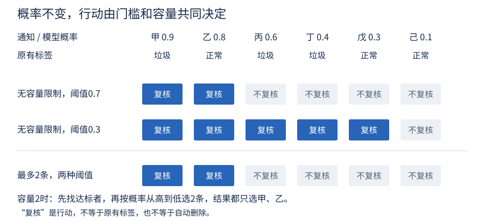

# 第10课 · 模型说“有八成可能”，接下来该怎么办？

上一课的模型预测一个数，例如某个小时会租出多少辆车。本课换成分类问题：一条短信更可能是正常短信，还是垃圾短信？

从这一课到第14课，我们会持续改进同一个短信分类项目。本课先不比较复杂模型，只把两件事弄清楚：模型怎样给出概率，以及这个概率怎样变成复核名单。

### 换了任务，哪些旧知识还管用？

第9课是回归任务，输出有单位的租借次数，MAE衡量平均差多少次。本课是二分类任务，目标标签只有正常/垃圾两类；模型先给概率，再由阈值和人手名额决定复核，不能沿用“误差多少次租借”的指标。

仍然保留的是：输入先变成数字、参数由训练资料学习、比较用同一批记录、不能只看训练表现。“验证集”和这里的“开发集”都用于比较和选择方案，但Bike与SMS是不同数据；旧Bike的参数、缩放值、阈值和已经看过的测试结果不能直接迁过来。第10—14课另保持SMS的同一train/dev及最终留出划分。

## 1. “属于哪一类”和“要不要复核”，是两个问题

数据中，每条短信都有一个原有分类，叫作**标签（label）**：

- ham：正常短信，本课编码为0；
- spam：垃圾短信，本课编码为1。

模型读到一条短信后，会估计它属于垃圾短信的**概率（probability）**。例如输出0.8，可以读作“模型估计它属于垃圾短信的概率为80%”。

原有标签是我们拿来核对的答案；概率是模型给出的估计。两者不能混在一起。

接下来还要决定是否送交人工复核。这个决定叫作**行动（action）**。本课action=1表示送交复核，action=0表示不送交。

送交复核不是认定它一定是垃圾短信，更不是自动删除。一个合理的安排，也可能把一些正常短信送去检查。

## 2. 先看六条通知，暂时不管概率怎么来的

下面是人工编制的小例，不是正式短信数据。为了看清规则，假设模型已经给出这些概率：

|通知|估计为垃圾的概率|原有标签|
|---|---:|---|
|甲|0.9|垃圾|
|乙|0.8|正常|
|丙|0.6|垃圾|
|丁|0.4|垃圾|
|戊|0.3|正常|
|己|0.1|正常|

乙的概率很高，却是正常通知；丁的概率较低，却是垃圾通知。这正是模型可能出错的地方。

先约定一条规则：“概率不低于0.7，就送交复核。”这个分界数叫作**阈值（threshold）**。本课规则包含等号：恰好等于阈值也达标。

按0.7的阈值，只有甲和乙入选。

拿入选名单与标签对照，会出现四种情况：

|实际标签|送交复核|不送交复核|
|---|---|---|
|垃圾|选对：真阳性（true positive，TP）|漏选：假阴性（false negative，FN）|
|正常|误选：假阳性（false positive，FP）|正确放过：真阴性（true negative，TN）|

这里把“垃圾短信”规定为正类（positive class），把“送交复核”作为预测为正的行动。这样数出的四格表也叫**混淆矩阵（confusion matrix）**。本课用它评价当前复核规则：改变容量也可能改变这四个数，即使模型的概率完全没变。

在阈值0.7下：

- 甲是选对，TP=1；
- 乙是误选，FP=1；
- 丙、丁是漏选，FN=2；
- 戊、己正确放过，TN=2。

四个数相加应等于6。漏选不能只在“已经入选的人”里找，要检查全部真实垃圾通知。

## 3. 降低门槛，有什么好处和代价？

把阈值从0.7降到0.3。现在甲、乙、丙、丁、戊都入选，只有己不入选。

|规则|选对TP|误选FP|漏选FN|正确放过TN|复核总数|
|---|---:|---:|---:|---:|---:|
|概率≥0.7|1|1|2|2|2|
|概率≥0.3|3|2|0|1|5|

降低门槛后，原来漏掉的两条垃圾通知找回来了，但也多复核了一条正常通知，总工作量从2条增加到5条。

这个过程没有重新训练模型，六个概率一个都没变。变化的是从概率到行动的规则。

### 查准率和召回率，分母分别是谁？

**查准率（precision）**问：“送去复核的通知中，有多少确实是垃圾？”

**查准率 = TP ÷（TP+FP）。**

**召回率（recall）**问：“所有真实垃圾通知中，有多少被送去复核？”

**召回率 = TP ÷（TP+FN）。**

本例的计算如下：

|规则|查准率：看入选者|召回率：看全部真实垃圾|
|---|---:|---:|
|概率≥0.7|1÷2=50%|1÷3≈33.33%|
|概率≥0.3|3÷5=60%|3÷3=100%|

不要只写一个“准确率”就结束。50%和33.33%都在描述第一种规则，却回答不同问题。

降低阈值通常会让更多记录入选。对于同一批固定概率，在没有容量限制时，已经入选的不会被移出去，所以选对数和误选数都不会减少；但查准率可能升，也可能降，不能说它一定下降。

若没有任何通知入选，查准率的分母为0，应写“未定义”。它不等于0%，更不等于100%。

## 4. 人手只能复核两条，怎么办？

前面暂时没有限制工作量。现在增加一条现实条件：最多只能复核2条。这叫作**容量限制（capacity constraint）**。

本课采用下面的安排：

1. 先找出概率达到阈值的通知；
2. 在达标者中，按概率从高到低排序；
3. 最多取容量允许的条数；
4. 若达标者不足，不为了填满名额再降低门槛。

如果概率并列，就按记录ID排序，保证同样的数据能得到同样的名单。

阈值0.7时，达标者是甲、乙，正好两条。阈值0.3时，虽然五条达标，但容量仍是2，最后也只选甲、乙。

**图1怎么读：**先看上两行，没有容量限制时，门槛改变了名单；再看下面一行，容量把名单截到了前两名。概率没变，门槛变了，实际名单却可能不变。

因此，本例不能仅靠降低阈值提高召回率。还需要增加容量、改进概率排序，或接受当前限制。

正式程序用“开发记录数×容量比例”向下取整得到名额数。例如4条记录、容量比例0.4，最多复核1条，而不是1.6条。报告里要同时写比例与实际条数。

## 5. 模型怎样从一段文字得到概率？

你也许会问：短信明明是文字，怎么会产生0.8这样的数？

先沿用上一课“每项输入乘系数，再相加”的思路。不同的是，这次要先把文字变成数字，并把最后的得分转换成0到1之间的概率。

### 第一步：把短信记成六个数

本课的起点使用**人工特征（handcrafted features）**，也就是人先决定从文字中数什么：

|特征|怎样得到|
|---|---|
|characters|字符总数，包含空格和标点|
|digits|数字字符个数，例如“2026”有4个|
|exclamations|感叹号个数|
|tokens|按程序的分词规则得到的词项个数|
|has_free|有没有完整词项free，有为1，没有为0|
|has_url|有没有匹配http://、https://或www.的网址标记，有为1，没有为0|

这里的“词项”叫作**词元（token）**，可以先理解为程序按规则切出的文字片段。本课的小写英文与数字切分规则很简单，不等于完整理解句子的意思。

例如人工短信“Free entry!”共有11个字符、0个数字字符、1个感叹号、2个词项，含free但没有网址标记。因此六个数是：

**11，0，1，2，1，0。**

有free不代表一定是垃圾短信。模型会结合多个特征，系数则由训练数据决定。正常短信同样可能说“free time”。

### 第二步：换到共同的数值尺度

字符数可能是几十或几百，有无free却只有0或1。程序像上一课一样，使用**标准化（standardization）**：

**标准化后的值 =（原值−训练均值）÷训练标准差。**

均值和标准差只由训练数据计算。对新短信使用同一套数，不能先拿开发数据重新计算。

例如某特征原值12，训练均值10、标准差4，标准化后为(12−10)÷4=0.5。若训练中某特征始终不变，程序把除数设为1，避免除以0。

### 第三步：算得分，再转成概率

每个标准化后的特征乘自己的系数，再加**截距（intercept）**，得到一个实数得分z：

**得分z = 截距 + 各项“标准化后的值×系数”之和。**

这与上一课的线性计算相似。但是得分可能小于0，也可能大于1，不能直接当概率。

虽然名称带“回归”，本课的**逻辑回归（logistic regression）**用于二分类：它先做线性加权，再用**逻辑函数（sigmoid function）**把得分转成概率：

**p = 1 ÷［1 + exp(−z)］。**

exp是指数函数，可用计算器或程序计算。这一课不要求推导它；先看三个对应值：

|得分z|得到的概率p|
|---|---:|
|−2|约0.119|
|0|0.5|
|2|约0.881|

得分越大，模型给的垃圾短信概率越高。

再用一个只有一个特征的人工小例：标准化后的输入为0.5，系数为2，截距为−1。

**z = −1 + 2×0.5 = 0，p = 1÷(1+1) = 0.5。**

这几个系数是为了手算给定的。真实程序使用训练短信学习系数；第12课会展开参数怎样一步步更新。本课先学会核对一次预测，以及保持预测不变时怎样选择行动。

## 6. 0.8真能理解成“十条里大约八条”吗？

模型给出0.8，是它的估计，不是已经得到保证的真实概率。

假设我们收集了很多被模型估计为“约0.8”的新短信。如果其中实际约80%是垃圾，这一组概率就与实际频率比较吻合。这种吻合程度叫作**校准（calibration）**。

如果实际只有约40%是垃圾，模型就显得过于自信。

少量记录会有随机波动，不能要求随手选10条就恰好8条垃圾；也不能凭一个分组吻合，证明整个模型已经校准良好。

排序、概率与行动是三个层次：

- 排序：高风险的记录有没有排在前面？
- 概率：0.8这样的数字与实际频率是否吻合？
- 行动：在费用和容量限制下，哪些记录值得复核？

本课标准任务主要研究第三个层次，并核对概率的计算过程；不要求再训练一个校准模型。

## 7. 三份数据各做什么？

正式任务使用公开的历史英语短信，不导入个人短信。数据已按相同或近重复短信分组，再固定划分，避免几乎相同的文字同时进入训练与评价。

- **训练集（training set，train）：**学习特征的均值、标准差和模型系数。
- **开发集（development set，dev）：**比较阈值、容量与后续方法。因为我们会反复看它，不能把它称为完全独立的最终检验。
- **最终留出集（final holdout set）：**留到第14课，整个方案选定后再首次评价。

本课的标准程序只读取train和dev。不要为了分数更好，提前查看最后一份的标签。

文件中的行号不是日期；这份历史语料也不能直接代表今天的中文短信。阅读时可以请AI解释英文，但正式模型仍接收原英文，不把翻译后的文本悄悄替换进去。

## 8. 怎样核对一条真实预测？

运行起点后，先看prediction_trace.json。它记录了一条开发短信的计算过程：

- id：这条短信的编号；
- feature_names：六个特征的顺序；
- x：标准化后的六个数；
- weights：六个系数；
- contributions：各项输入与系数相乘的结果；
- intercept：截距；
- logit：上述六项贡献加截距后的得分；
- probability：得分转换后的概率；
- action：当前阈值和容量下是否送交复核。

你可以先把六个contributions加上intercept，检查是否等于logit；再用逻辑函数检查probability。

如果要从文字开始查，就按id在dev.csv中找到原文，数出六个原始特征，再用representation.json中的mean和scale检查标准化。

最后核对action。达到阈值只是第一步；容量不足时，还要看它在达标记录中的排序。不要把“概率超过阈值，却没入选”直接当成程序错误。

这些文件都是同一次运行的结果。别拿旧模型的系数去核对新模型的概率。

## 9. 回到你的复核方案

正式任务不要求找出一个放之四海皆准的阈值。你需要先说明：更在意漏掉垃圾，还是占用过多正常短信的复核名额？现实人手最多能处理多少？

然后保持模型概率不变，在同一批开发短信上比较两种安排。可以只改阈值，也可以只改容量；先只改一个因素，更容易解释原因。

至少数清四类结果与复核总数，再算查准率和召回率。建议应解释收益与代价，而不只是说“这个分数更高”。

如果改变门槛后名单没有变化，也可能是一个有价值的结果：容量已经成为限制。把原因说明白，比继续试很多门槛、只挑一个好看的数字更重要。

## 接下来各课改变哪一段？

本课固定模型概率，研究复核规则；第11课保持任务不变，比较文字怎样变数字；第12课固定表示，研究系数怎样更新；第13课复用预训练表示；第14课根据前面的失败诊断选择完整系统，才做最终评价。改变一段时，把其他条件记清楚，避免把多处同时改变的结果归给一个原因。
