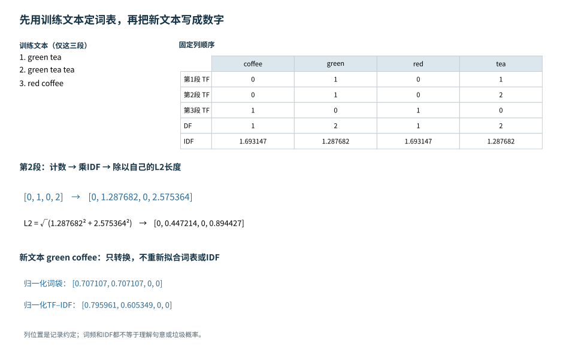

# 第11课 · 同一条短信，换一种记法会怎样？

计算机怎样把一条短信交给分类器？先看课程程序采用的一个简单办法：从每条短信中提取六项人工特征。看清这六个数怎样得到，再尝试让模型看到具体的词。

本课研究**表示**（representation）：怎样把原文转换成模型可用的数字，以及这种转换保留了哪些信息。

### 接上第10课：这次换的不是复核门槛

上一课先固定模型给出的概率，比较阈值和容量。本课把注意力移到前面：同样一条短信，怎样记成模型的输入？表示变了，原分类系数的坐标和尺度便不一定匹配，因此每种表示要重新训练自己的分类器，再在同一dev上比较。

本课用**文档向量**（document vector）表示整条短信：各位置按词表排列，数值是计数或TF–IDF权重。它不同于第13课介绍的预训练句子嵌入。参数更新怎样计算留到第12课；这里先把输入、转换和一次预测核对清楚。

## 先看一条短信怎样变成六个数

以 `Free tea!`（免费茶饮）为例。本课的人工特征按下面的固定顺序排列：

|位置|特征|怎样数这条短信|结果|
|---|---|---|---:|
|1|字符数|Free有4个字符，空格1个，tea有3个，感叹号1个|9|
|2|数字字符数|没有0至9的数字字符|0|
|3|感叹号数|有一个 !|1|
|4|分词后的词项数|转成小写、按规则拆开，得到 free、tea|2|
|5|是否含 free|含有这个词记1，没有记0|1|
|6|是否含网址标记|出现 http://、https:// 或 www. 记1，否则记0|0|

所以这条短信先记成 **`[9, 0, 1, 2, 1, 0]`**。六个位置含义固定，不能随短信改变顺序。字符数包括空格和标点；第5、6项记录“有没有”，不是出现次数。

再看几条说明性短信，用同一套规则计算：

|短信|字符数|数字字符数|感叹号数|词项数|含free|含网址标记|
|---|---:|---:|---:|---:|---:|---:|
|Free tea!|9|0|1|2|1|0|
|Free car!|9|0|1|2|1|0|
|Call 123!|9|3|1|2|0|0|
|Visit www.a.com|15|0|0|4|0|1|

`Call 123!` 拆成 call、123两个词项，其中123包含三个数字字符。`Visit www.a.com` 按程序规则拆成 visit、www、a、com四项；“词项”是拆词规则得到的片段，不一定是完整英语单词。

重点比较前两条：`Free tea!` 和 `Free car!` 的内容不同，六个数却完全相同。这套表示只专门记录了free是否出现，没有记录tea与car的区别。**如果模型只收到这六个数，它就无法区分这两条短信**。

程序随后会将每一列减去训练集均值、再除以训练集标准差，才送入分类器。这不会找回已经丢掉的词信息：前两条原始六项相同，标准化后的输入也相同。

下面换一种表示，直接记录“出现了哪些词、各出现几次”，看看能否保留更多信息。

## 1. 用词袋记录出现过的词

人工特征由人规定数什么；**词袋**（bag of words，BoW）先建立词表，再记录每个词出现几次。它保留词和次数，不保留顺序。

用三段人工文本学习这个过程：

- green tea
- green tea tea
- red coffee

词表按 coffee、green、red、tea 排列：

|文本|coffee|green|red|tea|
|---|---:|---:|---:|---:|
|green tea|0|1|0|1|
|green tea tea|0|1|0|2|
|red coffee|1|0|1|0|

第二段写成 `[0,1,0,2]`。按固定位置排列的一串数叫**向量**（vector）；这里有4个位置，即4维。训练和预测时，每个位置必须始终对应同一个词。

将第二段改成 tea green tea，向量不变。因此，同一个分类器也会给出相同得分：词序信息在进入模型前就已经丢掉了。

## 2. TF与DF：次数和文档数

一条短信或一段文本称为一篇**文档**（document）。

- **词频**（term frequency，TF）：某词在当前文档中出现几次。本课直接使用次数。
- **文档频率**（document frequency，DF）：训练集合中，有多少篇文档包含这个词。

第二段里 tea 出现2次，所以 $TF=2$ 。训练集合中第1、2段包含 tea，所以 $DF=2$ 。重复出现会增加当前文档的TF，每篇文档对DF最多贡献1。

小例的训练DF为： $coffee=1$ ， $green=2$ ， $red=1$ ， $tea=2$ 。

## 3. TF–IDF：调整常见词和少见词的权重

几乎每篇文档都有的词，通常较难用来区分文档。**逆文档频率**（inverse document frequency，IDF）给较少文档中出现的词较大权重。本课使用：

$$
\mathrm{IDF}=\ln\left(\frac{1+\text{训练文档数}}{1+\mathrm{DF}}\right)+1.
$$

ln是自然对数。小例有3篇训练文档：

|词|DF|IDF|
|---|---:|---:|
|coffee|1| $\ln(4/2)+1 \approx  1.693147$ |
|green|2| $\ln(4/3)+1 \approx  1.287682$ |
|red|1|1.693147|
|tea|2|1.287682|

将每个词的TF乘以IDF，就是**TF–IDF**。第二段变为：

`[0, 1.287682, 0, 2.575364]`。

IDF描述词在训练文本中有多常见。它不使用垃圾短信标签；哪些词有助于分类，要由后面的分类器学习。

## 4. L2归一化：比较词的相对构成

长短信通常包含更多词。为了让表示更侧重词的相对构成，可以将向量除以自身长度。记第 $j$ 个坐标为 $x_j$ ，对所有坐标的平方求和再开平方，得到**L2长度**（L2 norm）。

$$
\text{L2长度}=\sqrt{\sum_j x_j^2}.
$$

第二段的TF–IDF长度约为：

$$
\sqrt{1.287682^2+2.575364^2}\approx2.879.
$$

每项除以它，得到 `[0, 0.447214, 0, 0.894427]`。非零向量归一化后，各项平方之和为1。

本课BoW也默认使用L2归一化。在第二段中，green与tea的IDF相同，加权后只是整体放大，归一化又将这个倍数消去。因此它的BoW和TF–IDF结果恰好相同。

换一个新文本 green coffee，使用已经固定的训练词表和IDF：

|表示|归一化后的向量|
|---|---|
|BoW|`[0.707107, 0.707107, 0, 0]`|
|TF–IDF|`[0.795961, 0.605349, 0, 0]`|

coffee的IDF更大，因此在TF–IDF中占比更高。这个新文本只做转换，不加入训练集合重新计算IDF。

图中上半部分建立词表和IDF，下半部分展示加权、归一化及新文本转换。

归一化也会丢掉绝对数量：若所有词都重复两遍，归一化后的向量不变。

这里与第9、10课的**标准化**不同：标准化对某一特征列，利用train均值和标准差换算不同记录；本节L2归一化对每一条文本的整行向量，除以这一行自己的长度。不从dev重新拟合列统计量，但可以用固定规则计算每条dev向量自身的长度。二者都改变数值尺度，处理方向和所需资料却不同。

## 5. 未知词与训练集

用原词表转换 gold tea，gold没有对应位置，会被忽略；结果为 `[0,0,0,1]`。如果只有 gold，或输入为空，则得到零向量。程序保持它为零，分类器仍可用截距给出概率。

这些词称为**词表外词**（out-of-vocabulary，OOV）。它们提醒我们检查词表覆盖和分词规则。正式工具主要处理英文词与数字，具体规则见 [SUPPORT](SUPPORT.md)。

词表、DF、IDF，以及人工特征的均值和标准差，都只从train学习。dev使用保存的转换，供比较和选择；第14课再使用最终留出集。提前把dev加入词表拟合，会让表示看到评价数据，造成数据泄漏风险。

## 6. 正式数据：我们在预测什么？

正式练习使用历史英语短信，目标是找出可能的垃圾短信交给人工复核。先打开 `data/sms/dev.csv`：每行一条短信，`id` 是编号，`text` 是英文原文，`label` 是已有标签。`ham` 表示正常短信，`spam` 表示垃圾短信。

`train.csv` 有3877条，用来建立词表、计算训练统计量并训练逻辑回归；`dev.csv` 有807条，用来比较方案。模型从原文得到数字输入，不能把真实标签当作输入；dev标签用于检查哪些预测正确。

比较人工特征与词表示时，短信和标签没有更换，逻辑回归方法也没有更换。改变的是每条短信的数字表示，因此要在各自的表示上分别训练分类器。

## 7. 从表示到一条真实预测

表示完成后，逻辑回归仍按上一课的方法计算：

$$
\text{得分}=\text{截距}+\sum_j\text{表示数值}_j\times\text{分类系数}_j.
$$

再用 $\text{概率}=\frac1{1+\exp(-\text{得分})}$ 得到预测概率。IDF是表示阶段的统计量，分类系数则由带标签的训练数据学习。

下面追踪一次TF–IDF运行中的dev短信 `sms-00004`：

> U dun say so early hor... U c already then say...

大意是“你别这么早说……你看过之后再说……”。模型仍使用英文原文。分词结果为：

`u, dun, say, so, early, hor, u, c, already, then, say`

其中 hor 不在词表内，u 和 say 各出现2次。以 say 为例，这次训练集合有3877条短信，其中56条包含它：

|步骤|计算结果（约数）|
|---|---|
|计算IDF| $\ln((1+3877)/(1+56))+1\approx 5.220024$ |
|乘当前次数| $2\times IDF \approx  10.440047$ |
|除以该行L2长度17.150729| $value=0.608723$ |
|乘分类系数−0.130808| $\text{得分贡献}=-0.079626$ |

全部8个非零坐标的贡献合计约为−0.404794，加截距−2.053473，得分约为−2.458267。经过逻辑函数，概率约为0.078836，低于阈值0.5，因此没有进入复核名单。

这条记录展示完整链条：

**原文 → 分词 → 固定词表 → TF–IDF → 归一化 → 得分 → 概率**。

默认两方案比较中的 `second/prediction_trace.json` 可复核本例；完整命令和逐项复算见 [SUPPORT](SUPPORT.md)。`first` 使用人工特征，`second` 使用TF–IDF；两者分别训练。

## 8. 两个方案跑完，怎样判断？

先看配套默认示范：人工特征与TF–IDF各训练400步，学习率1、正则系数0.001、阈值0.5，复核容量不截断。两次都预测同一807条dev短信，其中123条标签为spam。

|结果|六项人工特征|TF–IDF|
|---|---:|---:|
|进入复核|113|12|
|找对垃圾短信TP|105|12|
|误选正常短信FP|8|0|
|漏掉垃圾短信FN|18|111|
|正确放过正常短信TN|676|684|
|查准率| $105/113\approx 92.92\%$ | $12/12=100\%$ |
|召回率| $105/123\approx 85.37\%$ | $12/123\approx 9.76\%$ |

TF–IDF选出的12条都是真正垃圾短信，所以查准率为100%；但另外111条垃圾短信没有选出，召回率很低。只看查准率，就会遗漏这个重要代价。这些是当前配置的实际结果，不能据此断言TF–IDF在所有配置或数据上都更差。

再追踪 `sms-00020`：标签是spam，人工特征给出的概率约0.999599，TF–IDF约0.304169。在相同0.5阈值下，前者选入复核，后者漏掉。可在 `paired_predictions.csv` 按id找到这条，再到dev原文中阅读内容。

你可以选择一个具体比较：

- 人工特征与BoW：逐词记录是否补上了原来遗漏的信息？
- BoW与TF–IDF：调整常见词权重后，哪些预测发生变化？

保持train/dev记录、分类器、训练预算、阈值及复核容量相同。每种表示分别拟合转换和分类器；同样的训练步数表示固定预算，不代表两者都达到了各自最好水平。

先看整体指标，再按ID检查同一条短信的两份预测。最后试一次未知词、空输入或词序改变，看看表示的局限。正式任务只需比较两种表示，具体要求见 [README](README.md)。

本课的目标是：**看清模型得到了哪些信息，再用比较结果决定是否换一种表示**。 历史英语短信的结果用于这次练习，应用到其他语言或时期还需要新的数据检验。
