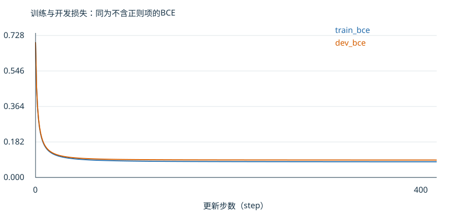

# 第12课 · 模型的系数，是怎样学出来的？

第11课我们把短信变成数字，并看到逻辑回归怎样用“系数×特征值＋截距”给出概率。现在追问：这些系数从哪里来？为什么同样的数据，有时训练很慢，有时一步改动过大？

本课先固定短信表示，再看训练过程；不会一边改词表、一边改学习率后猜原因。

## 1. 模型先做预测，再衡量预测错得多远

先用一个只有一个特征的人工小例。两条记录是：

|记录|特征x|标签y|
|---|---:|---:|
|甲|0|0|
|乙|2|1|

这里y=1表示正类，y=0表示负类。得分z＝w×x+b，其中w是特征系数，b是截距。预测概率p＝1/(1+exp(−z))。

先把w、b都设为0。两条记录的得分都为0，所以概率都为0.5。模型还没有从标签中学到区别。

用**损失（loss）**衡量概率与标签的差异。本课用二元交叉熵（binary cross-entropy，BCE）：

- 真实标签为1时，损失为−ln(p)。预测概率越接近1，损失越小。
- 真实标签为0时，损失为−ln(1−p)。预测概率越接近0，损失越小。

两条记录此时的损失都是−ln(0.5)≈0.693147，平均也为0.693147。损失是连续数值，与按0.5阈值统计“分对几条”不是同一个指标。

## 2. 梯度告诉我们，系数往哪个方向改

**梯度（gradient）**描述参数变化时损失的局部变化方向。先使用本课给出的逻辑回归计算式，不要求推导微分：

**w的梯度＝各记录(p−y)×x的平均；b的梯度＝各记录(p−y)的平均。**

对刚才两条记录：

|记录|p−y|(p−y)×x|
|---|---:|---:|
|甲|0.5−0＝0.5|0.5×0＝0|
|乙|0.5−1＝−0.5|−0.5×2＝−1|

所以w梯度为(0−1)/2＝−0.5；b梯度为(0.5−0.5)/2＝0。

**梯度下降（gradient descent）**按“新参数＝旧参数−学习率×梯度”更新。学习率控制每一步沿这个方向走多远。取学习率1：

- 新w＝0−1×(−0.5)＝0.5。
- 新b＝0−1×0＝0。

注意负号：w梯度为负，减去它后，w反而增大。

## 3. 改完以后，重新算一次预测和损失

甲的x=0，得分仍是0，概率仍是0.5。乙的x=2，得分变成0.5×2＝1，概率为1/(1+exp(−1))≈0.731059。

两条损失变成0.693147和−ln(0.731059)≈0.313262，平均约0.503204，低于更新前的0.693147。

这一步已经体现训练：先预测→计算每条记录的贡献→求平均梯度→更新参数→重新预测。本例一次使用全部两条记录；正式程序一次使用全部训练短信，叫**完整批量更新（full-batch update）**。不能把某一条短信的贡献直接当成全体梯度。

## 4. 正式训练为什么还多出一个正则项？

正式程序在平均BCE之外加上 **L2正则项＝λ/2×所有特征系数平方之和**。它约束系数过大，λ决定约束强度。本课截距b不受这一项惩罚。

因此每个特征系数的梯度，还要加λ×该系数；截距梯度不加。小例用λ=0；正式默认λ=0.001。零初始系数使第一次更新的正则梯度为0，但后面的更新一般不再为0。

本课也支持训练样本权重：若垃圾短信权重为c，求平均时分母是所有样本权重之和。默认c=1，每条训练短信同等计入。比较学习率或停止点时，先固定这些约定。

## 5. 到真实短信中核对一次更新

继续用第11课数据：train共3877条，512条标签是spam；dev共807条，用于比较，不参与梯度计算。默认采用已解释的六个人工特征，按train均值和标准差转换，w和b从0开始。

因为初始预测都是0.5，截距梯度可以直接核对：

**(3877×0.5−512)/3877≈0.367939。**

学习率1时，新截距为−0.367939。它反映训练集中正类少于一半，不能据此直接决定任何单条短信的最终标签。

字符数对应的系数，程序对全部训练记录求和得到：

- Σ[(p−y)×标准化字符数]≈−483.523265。
- 除以3877，梯度≈−0.124716。
- 原系数0，更新为0−1×(−0.124716)≈0.124716。

第一条训练短信sms-00001的标签为0，标准化字符数约0.508998，所以它对未除分母的和贡献0.5×0.508998≈0.254499。这是正贡献；其他3876条一并计算后，最终总和却是负的。由此可以看清“一条记录贡献”和“完整批量梯度”的区别。

默认第一次更新后，完整训练目标从0.693147降到0.462075。这两个数包含相同的正则约定。如何从输出复算，见[SUPPORT](SUPPORT.md)。

## 6. 为什么要同时看训练与开发曲线？

`curve.csv`每行是一次更新之后的状态。step=0表示还没更新，step=1表示已经更新一次；不是“一行一条短信”。

- `train_objective`：实际优化的训练目标，含正则项。
- `train_bce`：训练集上不含正则的BCE。
- `dev_bce`：开发集上不含正则的BCE。

比较训练与开发误差时，可先看后两条同口径曲线；不能把“含正则的训练目标”与“不含正则的开发损失”的差，全解释成泛化差距。

图中横轴为更新次数，蓝线是训练BCE，橙线是开发BCE；两线都不包含正则项。先看开头下降，再看后期变化是否已经很小。图来自配套默认配置的实际运行，精确值在curve.csv。

默认训练通常平稳下降；平稳下降同样是有效观察。另一个已验证的参考是学习率50：第一步训练目标由0.693147升到1.160856，说明梯度方向局部有用，也可能因一步走太远而让损失上升。这不是要求你必须做出震荡。

如果训练BCE继续下降、开发BCE却开始持续上升，可能说明继续拟合没有带来更好的开发表现；还要结合波动、实际指标和数据条件判断。停止时机用dev选择，最终留出集不参与选择。

## 7. 本课怎样做一个有解释力的比较？

先固定第11课得到的一种表示。选择一个方向：

- **学习率比较：**改lr，保持更新步数、表示、初值、正则、样本权重及复核规则相同。
- **停止时机比较：**固定lr等设置，比较不同更新步数。保存完整曲线，用dev依据解释在哪一步停止。

先写预期：你担心训练不足、更新过大，还是继续训练没有开发收益？再选择设置并实际检验。报告一次真实梯度更新、两条轨迹、同一真实短信的概率变化，以及最终误选与漏选的取舍。

训练损失下降不保证每条短信的预测都会改善，也不保证某个复核阈值最合适。你可以依据证据保留原设置；本课的目标是理解和诊断训练过程。
