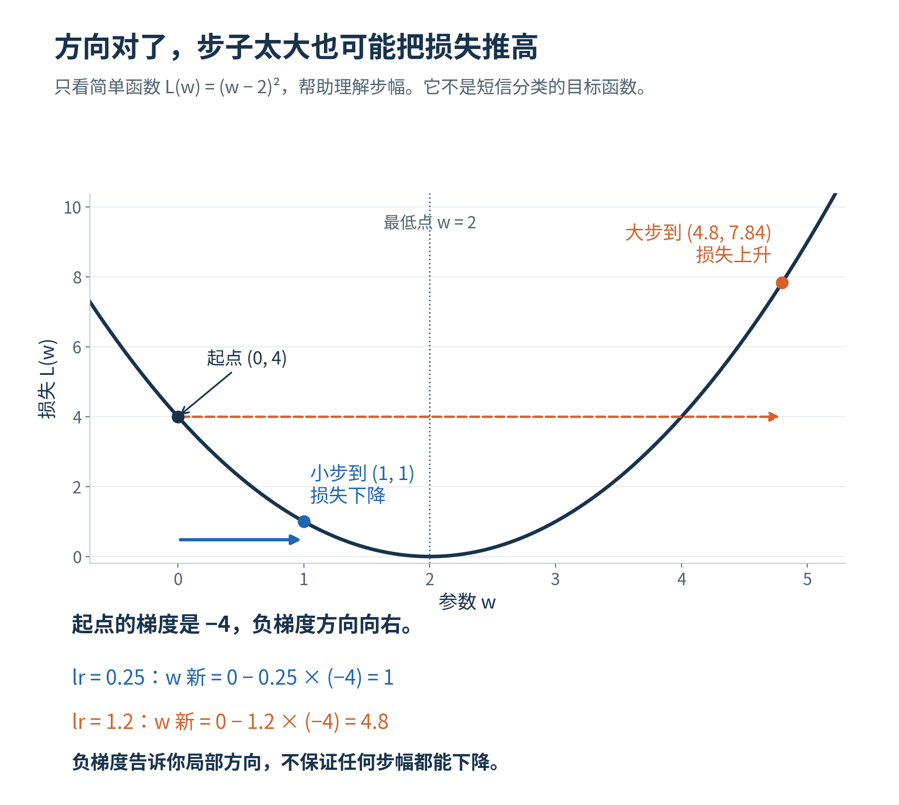
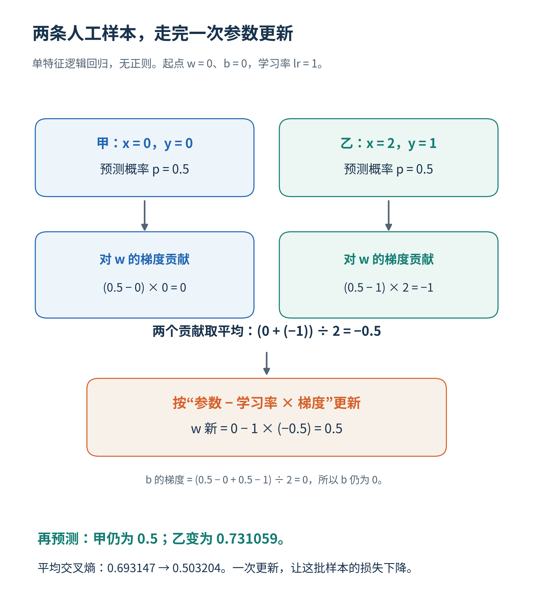
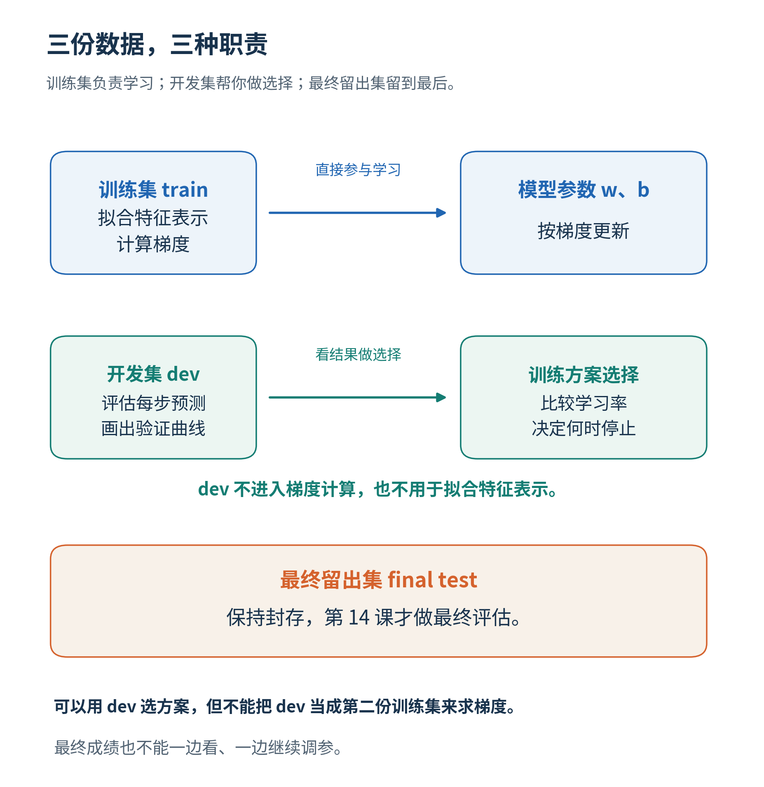
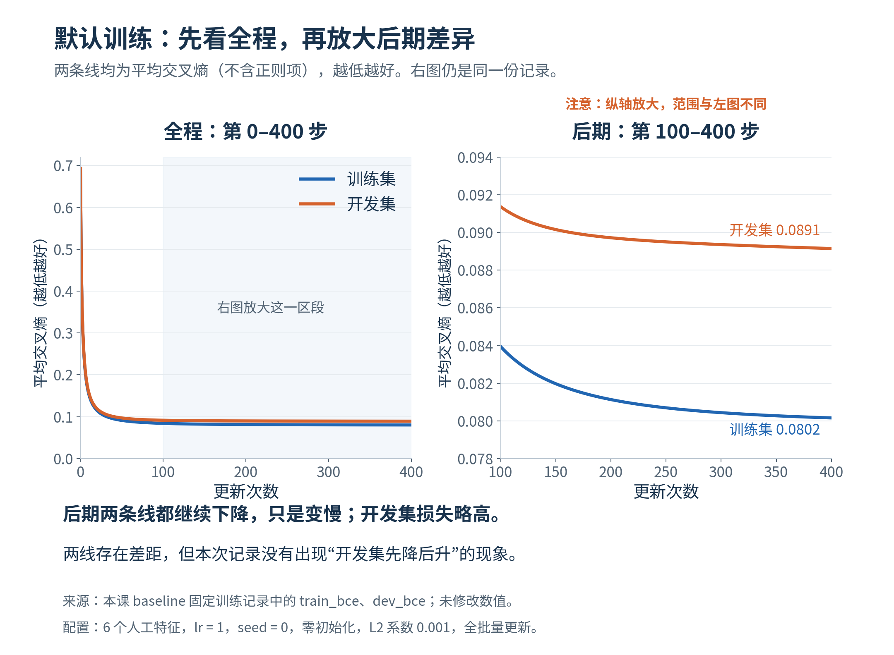
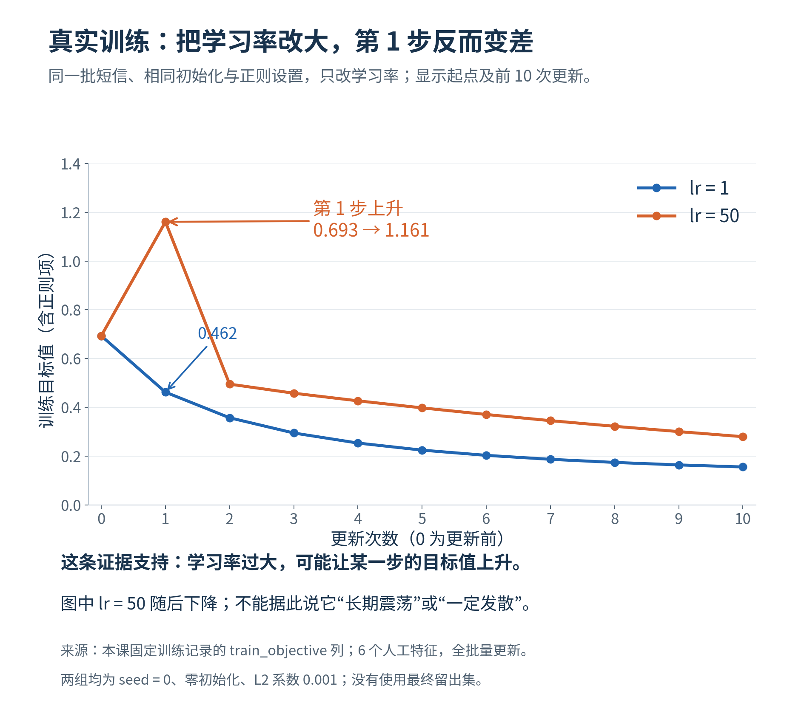

# 第12课 · 模型的系数，是怎样学出来的？

第11课我们把短信变成数字，并看到逻辑回归怎样用“ $\text{系数}\times \text{特征值}+\text{截距}$ ”给出概率。现在追问：这些系数从哪里来？为什么同样的数据，有时训练很慢，有时一步改动过大？

本课只抓住一条线： **先预测，看看错多少，再调整系数**。 比较时固定短信表示，只改变学习率或停止时机之一。

## 1. 模型先做预测，再衡量预测错得多远

先用一个只有一个特征的人工小例。两条记录是：

|记录|特征x|标签y|
|---|---:|---:|
|甲|0|0|
|乙|2|1|

这里 $y=1$ 表示正类， $y=0$ 表示负类。得分 $z=w\times x+b$ ，其中w是特征系数，b是截距。预测概率 $p=\frac{1}{1+\exp(-z)}$ 。这里p表示“属于正类的概率”；exp是指数函数，先用计算器或程序计算即可。

先把w、b都设为0。两条记录的得分都为0，所以概率都为0.5。模型还没有从标签中学到区别。

用 **损失**（loss） 衡量概率与标签的差异。本课用二元交叉熵（binary cross-entropy，BCE），在这里也称二元对数损失（log loss）：

- 真实标签为1时，损失为 $-\ln(p)$ 。预测概率越接近1，损失越小。
- 真实标签为0时，损失为 $-\ln(1-p)$ 。预测概率越接近0，损失越小。

ln表示自然对数。暂时不必推导公式，只看它的作用： **越自信地预测错，损失越大**。

两条记录此时的损失都是 $-\ln(0.5)\approx0.693147$ ，平均也为0.693147。损失是连续数值，与按0.5阈值统计“分对几条”不是同一个指标。

## 2. 梯度告诉我们，系数往哪个方向改

先把一个系数看成能左右移动的旋钮。 **梯度为正** ，表示这个系数稍微增大时，损失会增大； **梯度为负** ，表示稍微增大它时，损失会减小。训练要减少损失，所以往梯度的反方向改。

多个系数各有自己的变化率，合在一起叫 **梯度**（gradient） 。先使用下面的逻辑回归计算式，不要求推导微分：

用 $L$ 表示全部 $n$ 条训练记录的平均BCE， $x_i$ 、 $y_i$ 、 $p_i$ 分别是第 $i$ 条的特征、标签和当前预测概率。则：

$$
\frac{\partial L}{\partial w}
=\frac{1}{n}\sum_{i=1}^{n}(p_i-y_i)x_i,
\qquad
\frac{\partial L}{\partial b}
=\frac{1}{n}\sum_{i=1}^{n}(p_i-y_i).
$$

也就是：先算每条记录的贡献，再取平均。

对刚才两条记录：

|记录| $p-y$ | $(p-y)\times x$ |
|---|---:|---:|
|甲| $0.5-0=0.5$ | $0.5\times 0=0$ |
|乙| $0.5-1=-0.5$ | $-0.5\times 2=-1$ |

所以w梯度为 $(0-1)/2=-0.5$ ；b梯度为 $(0.5-0.5)/2=0$ 。

**梯度下降**（gradient descent） 按“ $\text{新参数}=\text{旧参数}-\text{学习率}\times \text{梯度}$ ”更新。**学习率**（learning rate）控制每一步沿这个方向走多远。取学习率1：

- 新 $w=0-1\times (-0.5)=0.5$ 。
- 新 $b=0-1\times 0=0$ 。

注意负号：w梯度为负，减去它后，w反而增大。

图用一个简单的碗形函数解释方向，不是短信模型的实际损失曲线。同一个下降方向，小步可能下降，大步却可能越过低点后升得更高。

## 3. 改完以后，重新算一次预测和损失

甲的 $x=0$ ，得分仍是0，概率仍是0.5。乙的 $x=2$ ，得分变成 $0.5\times 2=1$ ，概率为 $\frac{1}{1+\exp(-1)}\approx0.731059$ 。

两条损失变成0.693147和 $-\ln(0.731059)\approx0.313262$ ，平均约0.503204，低于更新前的0.693147。

按箭头再走一遍：先预测→计算每条记录的贡献→求平均梯度→更新参数→重新预测。本例一次使用全部两条记录；正式程序一次使用全部训练短信，叫 **完整批量更新**（full-batch update） 。不能把某一条短信的贡献直接当成全体梯度。

## 4. 正式训练为什么还多出一个正则项？

正式程序在平均BCE之外加上L2正则项：

$$
\frac{\lambda}{2}\sum_j w_j^2.
$$

其中 $w_j$ 是第 $j$ 个特征的系数。这种**正则化**（regularization）约束系数过大，λ决定约束强度。本课截距b不受这一项惩罚。

因此每个特征系数的梯度，还要加 $\lambda\times\text{该系数}$ ；截距梯度不加。小例用 $\lambda=0$ ；正式默认 $\lambda=0.001$ 。零初始系数使第一次更新的正则梯度为0，但后面的更新一般不再为0。

默认每条训练短信同等计入。如果改变垃圾短信权重，梯度的平均方式也会改变。本课先不改它，只比较学习率或停止点。加权计算可按需查操作参考。

## 5. 到真实短信中核对一次更新

继续用第11课数据：train共3877条，512条标签是spam；dev共807条，用于比较，不参与梯度计算。默认沿用第11课的六个人工特征。这里先只追踪“字符数”这一个系数：把字符数减去train中的平均数，再除以train中的标准差，得到标准化字符数。大于0表示比训练短信的平均长度更长，不代表“垃圾短信”。所有w和b从0开始。

因为初始预测都是0.5，截距梯度可以直接核对：

$$
(3877\times 0.5-512)/3877\approx 0.367939.
$$

学习率1时，新截距为−0.367939。它反映训练集中正类少于一半，不能据此直接决定任何单条短信的最终标签。

字符数对应的系数，程序对全部训练记录求和得到：

-  $\sum_i(p_i-y_i)\times\text{标准化字符数}_i\approx-483.523265$ 。
- 除以3877，梯度≈−0.124716。
- 原系数0，更新为 $0-1\times (-0.124716)\approx 0.124716$ 。

第一条训练短信sms-00001的标签为0，标准化字符数约0.508998，所以它对未除分母的和贡献 $0.5\times 0.508998\approx 0.254499$ 。这是正贡献；其他3876条一并计算后，最终总和却是负的。由此可以看清“一条记录贡献”和“完整批量梯度”的区别。

默认第一次更新后，完整训练目标从0.693147降到0.462075。这两个数包含相同的正则约定。如何从输出复算，见[SUPPORT](SUPPORT.md)。

## 6. 为什么要同时看训练与开发曲线？

训练集负责算梯度和更新系数；开发集帮助选设置，但不进入梯度；最终留出数据到第14课再评价。

`curve.csv`记录初始状态和每次更新后的状态。step=0表示还没更新，step=1表示已经更新一次；不是“一行一条短信”。

- `train_objective`：实际优化的训练目标，含正则项。
- `train_bce`：训练集上不含正则的BCE。
- `dev_bce`：开发集上不含正则的BCE。

比较训练与开发误差时，可先看后两条同口径曲线；不能把“含正则的训练目标”与“不含正则的开发损失”的差，全解释成泛化差距。

先看左图的完整训练过程，再看右图放大的后期。两图纵轴范围不同，不要把放大后的差异当成突然变大。蓝线是训练BCE，橙线是开发BCE，都不含正则项；精确值在curve.csv。

默认训练通常平稳下降；这同样是有效观察。

这张图比较的是 **含正则的训练目标** ，不是上一图的BCE。学习率50时，第一步由0.693147升到1.160856；学习率1时降到0.462075。第一次更新的梯度方向相同，步幅不同，结果可以相反。它说明这一步走得过大，不是要求每次实验都出现震荡。

如果训练BCE继续下降、开发BCE却开始持续上升，可能说明继续拟合没有带来更好的开发表现；还要结合波动、实际指标和数据条件判断。停止时机用dev选择，最终留出集不参与选择。

## 7. 本课怎样做一个有解释力的比较？

先固定第11课得到的一种表示。选择一个方向：

-  **学习率比较**： 改lr，保持更新步数、表示、初值、正则、样本权重及复核规则相同。
-  **停止时机比较**： 固定lr等设置，比较不同更新步数。保存完整曲线，用dev依据解释在哪一步停止。

先写预期：你担心训练不足、更新过大，还是继续训练没有开发收益？再选择设置并实际检验。报告一次真实梯度更新、两条轨迹、同一真实短信的概率变化，以及最终误选与漏选的取舍。

训练损失下降不保证每条短信的预测都会改善，也不保证某个复核阈值最合适。你可以依据证据保留原设置；本课的目标是理解和诊断训练过程。

## 把本课的训练语言接到下一课

第9课的一元最小二乘小例可直接算出系数；逻辑回归通常通过反复更新降低损失。本课不是换一套分类任务，而是打开第10、11课程序中原先只调用的训练步骤。评价指标仍看用途，不能因为优化损失下降，就自动宣布复核效果或实际服务已经变好。

同样的“参数→预测→损失→更新”思想还可用于神经网络。先把它理解为带有更多参数、由多层数值变换组成的模型即可；不需要现在训练它。语言模型也是在某种文本训练目标下学习参数的模型，而训练目标与最终使用效果并不完全相同。第13课会先解释这些模型的来源，再区分别人已训练的参数与我们要训练的分类头，当前仍只要求掌握本页的逻辑回归更新。

这里的“轮/步”是算法更新次数；统计课的“重复抽R份样本”是另一个概念。多更新一步没有自动增加新的独立数据。
