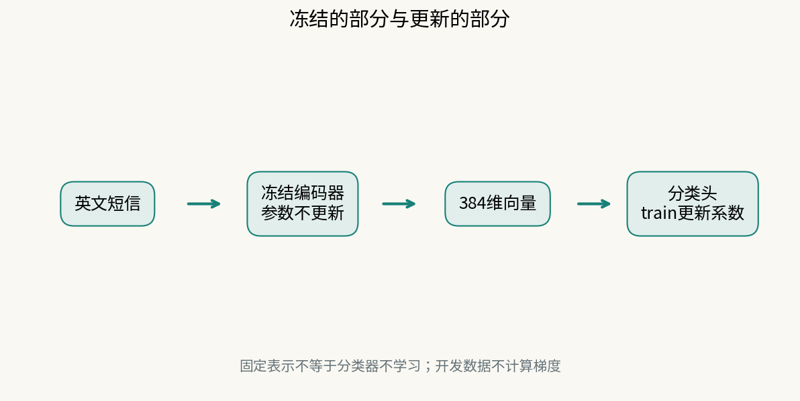
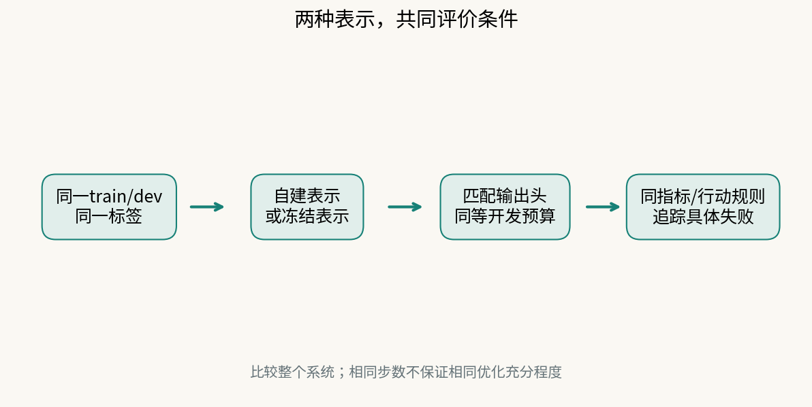

# 第13课｜从自己设计特征，到复用已经学好的表示

**上一课我们学会了训练分类器。这一课只改变它前面的“文字变数字”部分。** 先弄清为什么要换、谁已经训练过这部分，再去运行模型。你不需要预先学过神经网络，也不需要从头训练一个语言模型。

## 1. 第11、12课解决了什么，还留下什么？

第11课有三种把短信变成数字的办法：

- **人工特征 manual**：由我们规定提取字符数、数字等信息。特征含义清楚，但规则没写进去的信息可能丢掉。
- **词袋 bow**：建立词表，数每个词出现几次。一元词袋不记录词序，也不会因为两个词意思相近就自动把它们合并。
- **TF–IDF**：仍以词为坐标，利用训练文本中的词频给坐标加权。它改变词的权重，不会自动变成句子意思。

第12课固定其中一种表示，训练后面的逻辑回归系数。你已经会计算：特征→得分→概率→损失→更新系数。

现在多问一句：**如果有用的信息在“变成数字”时就没有保留下来，后面的系数训练得再久，能补回来吗？** 对于已经变成完全相同向量的两条输入，仅靠同一个确定性分类器不能把它们区分开。换表示值得检验，但不保证一定更好。

本课与前后课的关系：第11课选表示，第12课理解分类器怎样训练，第13课尝试另一种表示来源，第14课区分失败原因并做最终评价。短信数据、训练方法和评价问题都延续，不突然另开一个项目。

## 2. 为什么会有“已经训练好的模型”？

第12课的训练也可以用于更复杂的函数：不由人逐项指定“字符数是多少”，而是让带有许多参数的函数从训练任务中学会怎样处理输入。**神经网络**可以先理解为这样的可训练函数：多层数值变换依次处理输入，中间包含非线性变换；参数会根据训练误差调整。它不是固定词典，也不是装着标准答案的表格。本课不要求推导其内部各层。

训练一个通用文本模型通常需要较多数据和计算。模型开发者可以先在外部语料和训练任务上训练，再发布模型结构、已学好的参数以及配套分词规则。其他人便不必把所有参数重新从随机值开始训练。

**预训练（pretraining）**指在当前下游任务之前已经完成的训练；**预训练模型**不是“从来没训练过的现成算法”，而是保存了那次学习结果的模型。训练信号可以来自文本自身构造的任务，也可以来自句子关系等其他任务；并不是所有模型都只用无标签资料。本课没有重新执行模型作者的训练，也不凭空指定它每一步用了哪些资料。

一个典型的句子表示训练思路，是让表达相关意思的句子产生更有用的向量关系。它优化的未必是我们的“垃圾短信/正常短信”标签。因此“会生成句子表示”和“已经会判别本班的垃圾短信任务”是两回事。

图的上半部分发生在本课之前，下半部分才使用我们的短信train标签。外部学习结果通过一份模型文件被复用，不是每次预测都把短信发给某位模型作者。

## 3. 本课复用的是什么，不是什么？

本课使用 Sentence Transformers 发布的 `paraphrase-MiniLM-L3-v2`。它是**文本编码器（text encoder）**：输入一句文本，输出一个向量，也叫**句子表示/嵌入（sentence embedding）**。这里的“编码”不是密码加密，而是把输入变成后续算法可以使用的数。

该模型每句输出384个数。384是表示的维数，不是384种垃圾短信类别；它不会在这一步直接给出spam标签。模型原始说明把它用于句子表示、聚类或语义检索。本课用固定的本地CPU模型文件，不是聊天机器人，也不需要向付费聊天API提问。[模型原始说明](https://huggingface.co/sentence-transformers/paraphrase-MiniLM-L3-v2)

“借来的模型”只是口语说法，准确地说是**复用外部已经学好的表示函数及其参数**。下面用“预训练编码器”，不把它当黑箱代称。

假设短信原文是x，编码器参数是θ，则表示写成：

**h = gθ(x)。**

g表示“编码器做的转换”，θ是它已学好的参数，h是转换结果。与manual/bow/tfidf相比，后面的分类器仍然接收数字；变的是这些数字怎样得到。

这种把先前学习的结果用于新任务的做法属于**迁移学习（transfer learning）**。图像任务也可以复用图像特征网络后再训练分类层，原理类似，但本课只实际做英文短信。

## 4. 先看一个与正式短信任务分开的真实小例

三个教学用英文句子是作者另写的，不是正式短信数据，也没有业务标签：

1. The meeting has been postponed.（会议被推迟。）
2. The appointment will take place later.（会面将稍晚举行。）
3. The cat is sleeping on the sofa.（猫在沙发上睡觉。）

只保留词表[meeting, postponed, appointment, later, cat, sofa]并数词，三句分别成为[1,1,0,0,0,0]、[0,0,1,1,0,0]、[0,0,0,0,1,1]。这是刻意限定词表的人工词袋小例：它看不到第1、2句关于安排延后的联系，不是说所有词袋实验都产生这三个向量。

把同三句实际送入本课固定编码器后，可以比较向量的**余弦相似度**：它比较方向，数值越大表示按这套表示衡量越相似；不是概率，也不是准确率。本课向量已经调成长度1，所以相似度就是对应坐标乘积再求和。

|比较|本课固定模型的实际结果|
|---|---:|
|第1句与第2句|约0.3480|
|第1句与第3句|约0.0827|

此处第1、2句的表示更相似。这是一个具体观察，不能证明模型总能理解同义词、否定、编号或所有长句，更不能证明垃圾短信分类一定更准。完整向量、版本与计算结果见[小例数据](examples/meaning-comparison.json)；[运行帮助](SUPPORT.md)提供独立复算入口。

**因此值得测试的假设是：先前学到的文本规律能否帮助我们的任务，而不是“别人训练过，所以必胜”。**

## 5. 既然模型已经训练过，本课还训练什么？

把两段明确分开：

**英文短信x → 预训练编码器gθ → 向量h → 逻辑回归w、b → 概率p → 复核规则。**

- **冻结（frozen）编码器**：本课训练时保持θ不变。它仍会执行计算，把每条输入变成向量，不是“冻结后不运行”。
- **训练分类头（classification head）**：后面的逻辑回归是当前任务的输出层。我们用短信train标签学习它的w、b，这正是第12课的更新过程。
- **推理（inference）**：用已经确定的参数计算某条输入的结果，不因计算一次预测就自动更新参数。

|做法|编码器参数θ|短信分类器w、b|本课是否做|
|---|---|---|---|
|从随机初值训练整套模型|在当前任务中学习|学习|不做|
|冻结预训练编码器，训练新分类头|沿用已学参数、不更新|从train标签学习|本课主线|
|微调预训练编码器|从已有参数出发继续更新|通常也学习|仅理解区别，不要求运行|

**微调（fine-tuning）**是以已有模型参数为起点继续训练，不等于仅仅下载或运行模型。本课采用冻结方案，是为了接上第12课、控制计算资源并看清两段职责，不是说微调一定不好。

图中应追问两个问题：哪些参数已经由外部训练过？哪些参数现在用我们的train标签更新？不要把冻结误解为整个系统没有学习，也不要把dev标签拿去更新任何参数。

## 6. 用第12课的方法，完整算一次分类头

以下是人工小例，不是预训练模型的真实输出。设h=[0.2,0.5]，w=[1,−2]，截距b=0.3。

- 得分 z = w·h+b = 0.2×1+0.5×(−2)+0.3 = −0.5；
- 概率 p = 1/(1+exp(−z)) ≈ 0.377541。

只把w第二项从−2改成−1，h仍为[0.2,0.5]，新得分是0，概率变成0.5。**表示不变，分类器仍能学习并改变预测。** 反过来，只重新计算同一输入的h而不训练w、b，并不等于做了一次第12课的参数更新。

两个数只是方便手算；正式模型计算384项乘积之和。向量与分类系数长度和坐标含义都必须匹配，不能拿六项人工特征的w直接乘384维h。

## 7. 再回到一条真实短信

默认训练3877条train，用807条dev评价。模型文件保持不变，分类器从零初始、学习率1、400步、L2系数.001训练。第一条dev短信 `sms-00004` 是：

“U dun say so early hor... U c already then say...”

原英文直接进模型，中文解释只能帮助阅读，不能在比较时偷偷用翻译替换输入。默认 `prediction_trace.json` 保存全部向量、系数和贡献。以下三个坐标编号从0开始，是贡献绝对值较大的例子：

|坐标|向量值|分类系数|乘积贡献|
|---|---:|---:|---:|
|66|.100936|−1.578354|−.159313|
|335|.081494|−1.291816|−.105275|
|34|−.084806|1.213862|−.102943|

这三项不是全部得分。全部384项的和约−1.873376，加截距−2.182067，得到z≈−4.055443，概率≈.017033。默认门槛.5且容量不约束时，action=0，即不送复核。

**核对重点是“原文→正确向量→匹配系数→全部贡献之和→概率→行动”，不是抄384个数。** 小数因显示舍入可能略有差别，以原始JSON为准。

## 8. 怎样检验迁移是否真的有用？

你选择manual、bow或tfidf中的自建表示，与冻结表示在同一个任务、同一train/dev划分上比较。共用标签、指标、阈值/容量规则和可接受代价；若调学习率或停止点，给双方同样的开发尝试预算。

相同的400步是一个透明基准，不一定让不同特征都训练到同样充分。先看训练/开发曲线，再解释比较在控制什么。人工表示仍可能胜出；预训练没有优势是可以报告的结果。

读图先看两条路线共享哪些条件，再看只在哪一步分开。模型不能从dev计算词表、缩放参数或梯度；dev只用于选择。最终留出仍到第14课定案后才评价。

用真实失败记录追问：是哪一类信息、哪一种训练限制或哪一种复核门槛与名额可能影响结果？只看总体准确率不够，尤其spam比例低时，要区分误选、漏选和复核人数。

## 9. 理解原理后，再看运行细节

**词元（token）**是分词器拆出的片段，不一定等于一个英文单词。当前模型最多接收128个词元；超长文本被截断，丢掉的信息不能由分类头凭空找回。

**缓存（cache）**是提前算好并保存的向量。缓存用于节省重复计算，不是一个新的模型；若原文、顺序、模型或处理步骤变了，旧缓存可能不再匹配。新写或改写的英文必须真的重新编码，不能只改报告文字或旧文件名。ID是记录的编号；内容指纹是根据文本计算的校验值，可帮助发现内容变动。先用ID和原文确认向量与标签逐条对应，不能只检查行数和列数。

384个坐标通常没有“第66维就是某个词”的固定解释。我们能核算一项对得分的贡献，不能据此编造语义或因果含义。

底层文件格式、向量归一化、版本指纹及复算命令放在[SUPPORT](SUPPORT.md)。初学时先抓住来源、两段职责与比较理由，不需要先记住ONNX或attention mask才能理解迁移学习。

## 10. 本课的结论边界与下一课

外部训练资料是否含有类似短信，不能由本课保证。固定模型与缓存不意味着它没有外部知识；本课也没有证明当前英语语料能代表未来所有用户。

预训练表示可能不适合缩写、编号或特定领域；更多维度不保证更好。Sentence Transformers官方文档也强调，需要在自己的任务上做实验，而不是只凭模型榜单决定。[官方使用说明](https://sbert.net/docs/sentence_transformer/pretrained_models.html)

本课结束时，你应能解释：为什么考虑另一种表示、预训练发生在什么时候、哪些参数在本课更新，以及一次比较能支持多大范围的结论。第14课再问：失败究竟更像表示丢失信息，还是训练或规则没有选好？我们不会因为换了模型名称就跳过这一步。

本课已核验Linux x86_64 CPU推理；其他平台由教师课前确认。模型及Apache-2.0许可、固定版本见[模型清单](../data/sms/encoder/manifest.json)。本课不要求GPU、付费模型、课堂下载大文件或重新预训练。
