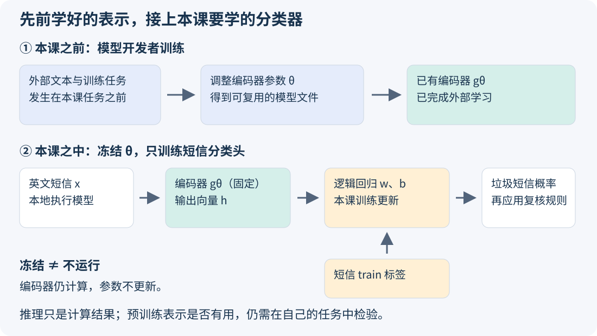

# 第13课｜预训练表示与迁移学习

第11课用人工特征、词袋和TF–IDF表示短信，第12课学习如何训练逻辑回归。本课继续使用同一批短信，改用预训练文本编码器提取特征，再训练自己的分类器。

## 1. 从人工特征到学习得到的表示

人工特征由人规定，例如短信长度、数字数量；词袋以词频为特征，TF–IDF进一步调整词的权重。这些方法容易计算和解释，但一元词袋不记录词序，也不能直接表达近义词之间的关系。

另一种办法是让模型从大量文本中学习表示。神经网络（neural network）是一类由多层数值变换组成的可训练函数：训练时根据目标函数调整参数，使输出适合相应任务。文本编码器（text encoder）用这样的函数把文本转换为向量。

## 2. 预训练与迁移学习

模型开发者先在外部语料上完成训练，再发布模型及参数，这一过程称为**预训练（pretraining）**。训练任务可以来自文本自身，也可以来自句子之间的关系等信息。把已经学到的表示用于新的任务，属于**迁移学习（transfer learning）**。

本课使用 `paraphrase-MiniLM-L3-v2`，将每条英文短信编码为一个384维向量。它提供文本表示；垃圾短信的判断规则由后续分类器学习。[模型说明与文件（HF Mirror）](https://hf-mirror.com/sentence-transformers/paraphrase-MiniLM-L3-v2)

设短信为x，编码器为g，预训练参数为θ，则文本表示为：

**h = gθ(x)。**

本课保持θ不变，这叫**冻结编码器（frozen encoder）**；后接的逻辑回归称为**分类头（classification head）**，本课用短信训练集学习它的参数w、b。若从预训练参数出发继续更新θ，则称为**微调（fine-tuning）**。训练完成后，用固定参数计算新输入的结果称为**推理（inference）**。

## 3. 文本怎样进入编码器

模型计算的输入是数字。**分词器（tokenizer）**先把文本拆成词元（token），再按模型词表把每个词元转换成整数编号。词元可以是一个单词，也可以是单词的一部分；词元编号只是查表用的标识，不表示词义的大小。

例如，`The meeting has been postponed.` 被本课分词器处理为 `[CLS], the, meeting, has, been, postponed, ., [SEP]`。其中 `[CLS]`、`[SEP]` 是标记句子边界的特殊词元；`meeting` 对应词表编号3116。

本课的处理顺序是：

**英文短信 → 词元 → 词元编号 → 编码器 → 各词元的向量 → 汇总为384维句向量。**

不同长度的短信最终都得到384个数。这里的384是向量的坐标数，不是句子的词数。程序对有效位置的向量求平均，再除以向量长度，使句向量长度为1。批量处理时补齐的空位置不参与平均。

输入最多保留128个词元（包括模型使用的特殊词元），超出部分被截断。因此，较长短信末尾的信息可能未进入表示；128词元也不等于128个英文单词。

## 4. 向量怎样表示句子关系

比较三个教学句子：

1. The meeting has been postponed.（会议被推迟。）
2. The appointment will take place later.（会面将稍晚举行。）
3. The cat is sleeping on the sofa.（猫在沙发上睡觉。）

若词袋只使用[meeting, postponed, appointment, later, cat, sofa]六个词，三句的向量分别为[1,1,0,0,0,0]、[0,0,1,1,0,0]、[0,0,0,0,1,1]。这些向量未体现前两句的语义联系。

本课编码器输出的向量经过长度归一化（normalization），可用**余弦相似度（cosine similarity）**比较方向；此时相似度等于对应坐标乘积之和：**cos(h₁,h₂) = h₁·h₂**，其中两向量的长度均为1。

|句子对|固定模型的余弦相似度|
|---|---:|
|第1句与第2句|0.3480|
|第1句与第3句|0.0827|

在这个例子中，前两句的表示更相似。相似度描述向量关系，与垃圾短信概率是不同的量。[完整结果](examples/meaning-comparison.json)及[复算方法](SUPPORT.md#句子相似度小例)可供核对。

## 5. 从表示到分类概率

整条计算流程为：

**短信x → 编码器gθ → 向量h → 逻辑回归 → 概率p → 复核行动。**

逻辑回归沿用第12课的计算：

**z = w·h + b，p = 1 / (1 + exp(−z))。**

用一个二维向量手算：h=[0.2,0.5]，w=[1,−2]，b=0.3，则z=−0.5，p≈0.3775。若第二个系数改为−1，z变为0，p变为0.5。编码器的输出保持不变，分类头仍可通过更新系数改变预测。正式模型采用相同计算，只是向量扩展为384维。

## 6. 先理解缓存，再运行实验

冻结编码器后，同一条短信不必在每次分类器训练时重新编码。课程已把固定短信的句向量计算好并保存在文件中，这些可重复读取的中间结果称为**缓存（cache）**。模型文件保存计算向量的参数；缓存文件保存已经算出的向量，两者用途不同。

默认实验读取缓存，训练的是分类头w、b。只改变学习率、训练步数或复核门槛，可以继续使用这些向量；改变原文、分词设置或编码器后，需要重新编码。你新写的英文还没有缓存，将由本地模型即时编码。

模型及分词器已放在学生仓库的 `data/sms/encoder/` 中，固定短信向量在 `data/sms/cache/` 中。现在可按[运行帮助](SUPPORT.md)先训练默认分类头，再处理自己的英文输入。

## 7. 追踪一条真实短信

默认设置用3877条train短信训练分类头，在807条dev短信上评价。第一条dev记录 `sms-00004` 的原文为：

“U dun say so early hor... U c already then say...”

在默认400步训练后，全部384项乘积之和约为−1.873376，截距约为−2.182067，因此z≈−4.055443，p≈0.017033。门槛为0.5且容量不约束时，这条短信不进入复核名单。

运行结果中的 `prediction_trace.json` 保存了原文、向量、系数和各项贡献，可以据此核对完整计算。句向量也称为句子嵌入（sentence embedding），其坐标通常没有单独的词义解释，逐项贡献用于解释分类得分。

## 8. 比较两种表示

选择manual、bow或tfidf中的一种，与预训练表示比较。两种方案使用相同的train/dev划分、标签、评价指标和复核规则，并记录各自的训练设置与开发尝试次数。

相同步数不一定意味着训练同样充分，应结合训练曲线判断。在本任务中，重点比较误选FP、漏选FN和复核人数，再根据业务代价决定采用哪种方案。dev用于比较和选择；最终留出数据在第14课确定方案后评价。

预训练表示的效果取决于外部训练知识与当前任务的匹配程度。缩写、编号和领域用语可能产生不同表现，可以通过实际失败记录和新写的英文探针进一步分析。

## 小结

本课把“表示”和“分类”分成两段：复用预训练编码器提取特征，用当前任务的数据训练分类头。第14课将进一步根据实验区分表示、训练和复核规则对结果的影响。
