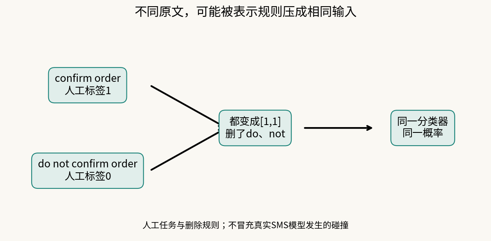
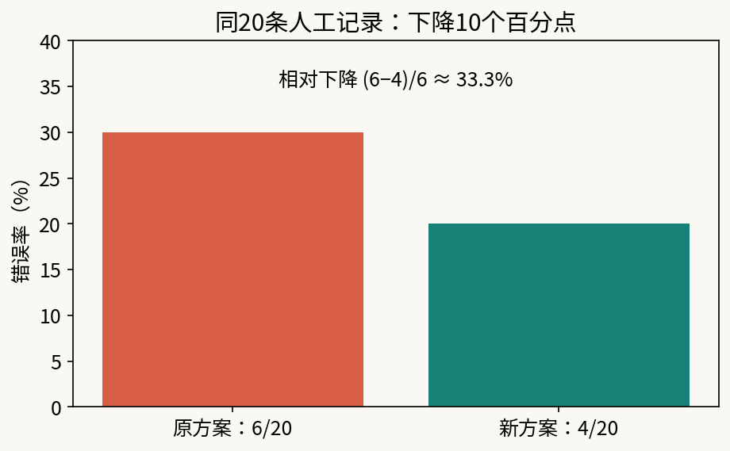
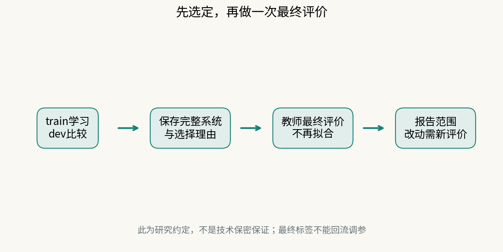

# 第14课｜同一个错误，两种解释，怎样分清？

第11课自己构造表示，第12课理解分类头的训练，第13课比较冻结的预训练表示与自建表示。现在手上已有不同表示、训练步数和复核规则的实际结果，不能只是“再调一调，看分数有没有更好”。你要对一个具体失败提出两个解释，设计能让它们产生不同预期的实验，再保存选定系统，第一次做最终评价。

### 与第8课的“对照实验”相比，这次多做什么？

第8课已经练过提出原因、固定其他条件、用对照削弱或支持解释。本课复用这种方法，不把它当突然出现的新术语。变化是：你现在能区分表示、训练和复核规则这三个环节，并要把前几课的选择收束成一个完整系统，再使用此前没有参与选择的最终留出资料。

因此不是“再调几个参数交一次分数”，而是回答失败更可能来自哪里、这项实验能区分什么、证据不足时该保留什么判断。完全相同向量的小例接上第11课表示信息丢失，第13课预训练也不保证消除这种限制。

## 1. 解释必须能说出不同预期

先看人工教学例子，不是正式SMS标签：任务是判断一句话是否确认订单。

- confirm order → 人工任务标签1；
- do not confirm order → 人工任务标签0。

假设某个表示规则删掉do和not，只保留confirm、order。两句就变成同一个向量[1,1]。

解释甲：“输入保留了必要差别，但训练不够。”解释乙：“表示已丢掉区分两句所需的信息。”如果向量确实完全相同，同一个确定性分类器只能给相同得分w·x+b和相同概率。无论训练多少步，都不能对这两个相同输入给出不同结果。

先看两句原文不同，再看两条箭头汇到同一个向量。关键问题是模型收到什么，而不只是人读懂了什么。这个结论针对相同输入的确定性分类器，不是说所有否定句都会被当前课包删掉；真实词表要实际查。

如果向量不同，增加训练步数可能帮助，但“不相同”不保证能线性分开，也不证明一定是训练不足。

## 2. 把两个解释变成区分实验

你在dev上选一个失败组或具体记录，写下：

|待区分解释|在什么观察下更受支持？|什么观察不能单独证明它？|
|---|---|---|
|现有表示足够，但尚未训练充分|固定表示和其他设置，增加训练后目标继续下降，相关失败组预测也改善|训练损失下降本身不保证dev改善|
|当前表示丢失了必要区分|关键记录在模型实际输入中碰撞；多训练仍不能区分|一次没改善不等于已证明信息永久丢失|

这只是可用方向，不要求全班选同一对解释。也可比较训练波动与数据条件变化，或概率排序问题与阈值取舍。先写可区分的预期，再改变一项；同时换词表、加步数、改门槛，即使改善也难解释原因。

**实验结果可以仍然区分不开。** 这时说明还缺哪项证据，而不是硬选一个故事。

## 3. 改善多少，要用相同记录和分母算

另设人工结果：同一20条dev记录，原方案错6条，新方案错4条。错误率从30%降到20%，是下降10个百分点，不是下降10%。相对下降为(6−4)/6≈33.3%。两种说法都要交代分母。

看哪些记录由错变对、哪些由对变错，不只看两个总数。同一记录跟踪可解释变化，但这个20条小组上的改善不保证适用于所有未来用户。

本课工具沿用第12课完整批量、零初值。固定数据和设置时重复运行通常得到相同结果，不能把十次相同输出当十次独立实验。如果确实要研究训练随机性，要提前说明随机来源、种子和重复次数，并保留全部结果。

## 4. 开发集也会被我们“用熟”

train用于学习参数，dev用于挑选方法。反复看dev、挑最好的阈值和失败组，会让系统逐渐适应这份开发资料。因此最终还需要一份没有用于这些选择的资料。

**最终留出评价（held-out evaluation）**在系统确定之后发生。它不负责帮你挑赢家，而是评价已经挑好的一个系统。先看最终结果再选择停止点或阈值，就把最终数据变成新的开发资料了。

本课固定划分按文本近重复组处理，减少明显重复跨集，但它不是时间外推实验，也不能保证没有语义相近内容。预训练语料是否见过相似文本也未知。最后分数不能直接证明可以上线。

## 5. “保存模型”要保存整套预测办法

需要保存：词表/IDF/缩放或编码器身份，分类系数与截距，训练停止点，概率门槛，批次复核容量，以及选择理由。只写“逻辑回归”或“MiniLM”不够还原结果。

`lock_system.py`复制实际参数文件，记录代码、数据划分及文件指纹。**定案（system selection）**是你依据开发证据作的决定，程序不会替你选最优。

例如保持概率不变而把门槛从.5改为.3，复核行动已改变，因此也是新系统。容量从100%改成10%同样改变系统；容量应作用于明确评价批次，并说明未来实际批次可能不同。

## 6. 最终评价的先后顺序

1. 仅在train/dev完成区分实验与选择，写下愿意接受的错误代价和使用条件。
2. 用定案工具保存选定目录，核对配置和指纹。
3. 交教师最终评价入口。教师使用原来固定的finalholdout，不重拟合词表或系数，返回记录与汇总。
4. 报告最终分数、误选/漏选和结果能够支持的人群与场景。若据此修改系统，明确原留出已被看过，新版需要新的独立评价。

最终记录另存，不放进日常重建命令反复“首次评价”。换目录或删除标记也不能让已看过的标签重新独立。公开数据的留出是研究约定，不是不可绕过的技术保险箱。

## 7. 模块作品怎样收束？

把第9–14课中的一件作品串成一条证据链：原问题→选择表示→理解训练→比较/诊断→定案→一次最终评价。可以保留旧方案、采用新方案，或说明证据不足而暂不实际使用。

不要把全部尝试堆成日志。挑能支持判断的关键数字，保留其可复现来源；同时记录一个曾经不支持你预期的结果。评价的是方案、证据和解释，不是模型越复杂越好。
